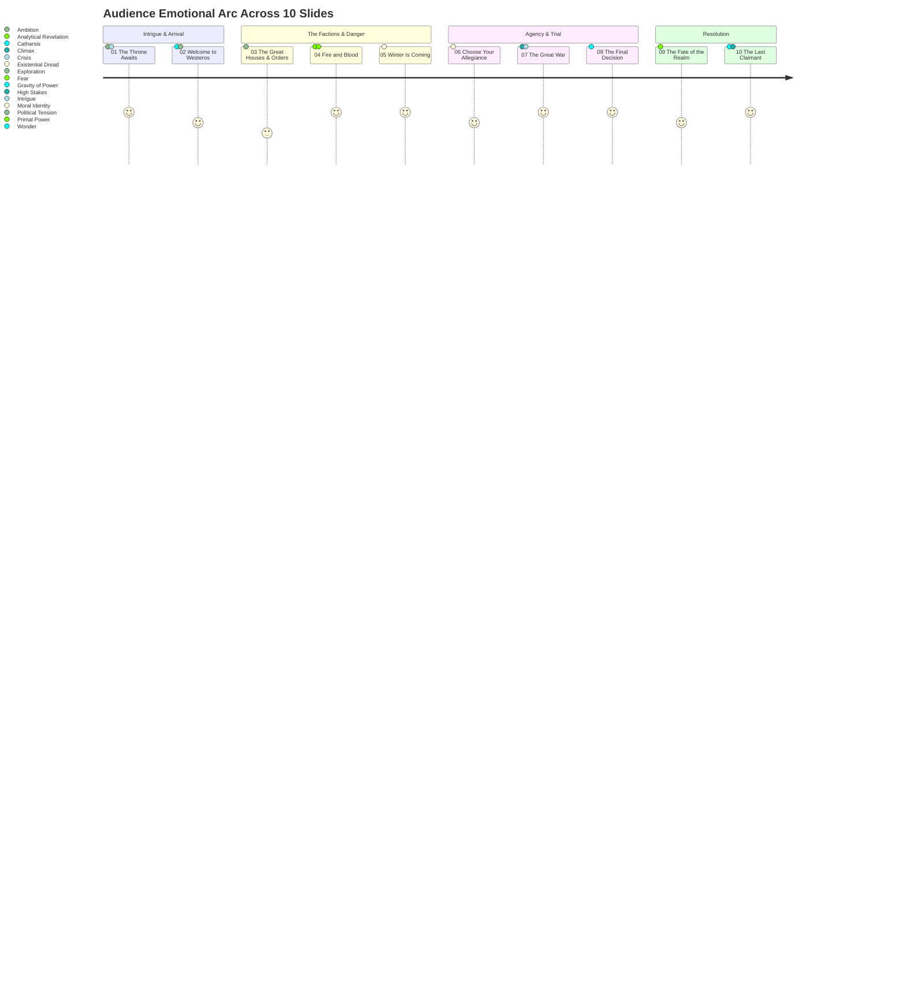
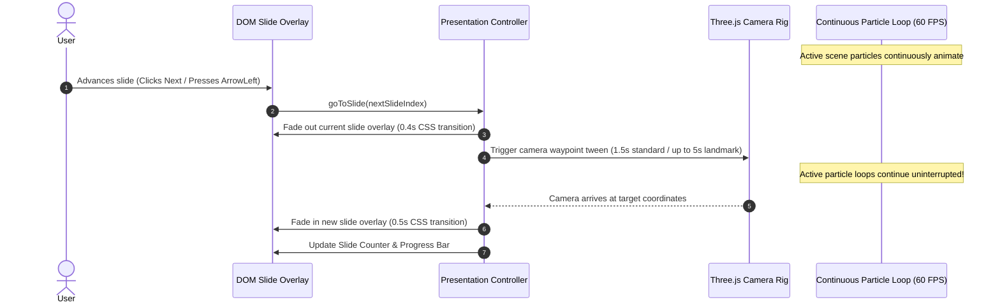

# Product Requirements Document (PRD)
## Game of Thrones — The Last Claimant (משחקי הכס — הטוען האחרון לכתר)

**Document Version:** 1.1.0 (Post-Red Team Hardened Specification)  
**Project Name:** Game of Thrones — The Last Claimant  
**Working Directory:** `C:\BIU01\HW\1`  
**Presentation Target:** `index.html` (Self-contained, Single-file)  
**Repository:** [https://github.com/sspirogan/game-of-thrones](https://github.com/sspirogan/game-of-thrones)  
**Document Status:** Working Draft — Under Second Independent Red Team Review  
**Course:** Generative AI University Course Project  
**Author Roles:** Senior Product Manager, Creative Director, Technical Architect  

---

## 1. Executive Summary & Document Control

### 1.1 Document Overview
This Product Requirements Document (PRD) establishes the definitive creative, narrative, functional, and technical specification for **Game of Thrones — The Last Claimant**. Designed as a university capstone project for a Generative AI course, the product transforms an initial placeholder HTML file (`index.html`) into an interactive, cinematic dark-fantasy web experience.

The audience adopts the persona of an unrecorded claimant to the Iron Throne, traveling across Westeros, navigating the lore of great houses and existential threats, confronting two high-stakes narrative dilemmas, and culminating in one of eight personalized ruling archetypes revealed at the Iron Throne.

### 1.2 Document Control & Metadata
| Field | Specification |
| :--- | :--- |
| **Product Name** | Game of Thrones — The Last Claimant |
| **Hebrew Title** | משחקי הכס — הטוען האחרון לכתר |
| **Target Deliverable** | Single self-contained `index.html` file (HTML5 + CSS3 + Vanilla ES6 JS + Three.js via CDN) |
| **Display Language** | Hebrew (`he-IL`) with comprehensive Right-to-Left (RTL) and Bi-directional (BiDi) text support |
| **Target Slide Count** | Exactly 10 slides (Fixed, no more and no fewer) |
| **3D Engine** | Three.js (r128+ loaded via official CDN with offline CSS fallback) |
| **Build & Tooling** | Python 3.10+ offline data generation and validation pipeline (no runtime backend) |
| **VCS Strategy** | Progressive Git versioning across structured academic milestones with semantic release tags |

---

## 2. Project Overview & Background

### 2.1 Academic Context
This project represents a synthesis of Generative AI workflows, advanced front-end creative engineering, and algorithmic storytelling. Developed for a university Generative AI curriculum, the project exemplifies how generative AI tools assist across the full product lifecycle: ideation, narrative design, data structuring, 3D math formulation, code scaffolding, localization auditing, and technical documentation.

### 2.2 Baseline State vs. Target State
* **Baseline State:** A minimal 157-byte HTML file (`index.html`) containing only a basic header (`<h1>Game of Thrones 🐉</h1>`) connected to a newly initialized GitHub repository.
* **Target State:** An AAA-grade interactive dark-fantasy presentation running at 60 FPS in standard modern browsers without any server-side dependencies. It combines cinematic 3D environments, animated camera choreography, dynamic lighting, continuous particle simulations (dragonfire embers, blizzards, mist), an interactive house quiz, a high-stakes moral decision, and an algorithmic ending reveal.

### 2.3 Core Value Proposition
Traditional digital presentations are passive, linear, and text-heavy. **The Last Claimant** replaces static slides with an interactive theatrical journey. By putting the user directly into the Westerosi political struggle as an active protagonist whose choices dictate the fate of the realm, the application bridges the gap between educational web presentations, cinematic gaming, and interactive digital fiction.

---

## 3. Product Vision, Pillars & Strategic Goals

### 3.1 Vision Statement
> *"To transport the user into the fractured realm of Westeros as the forgotten heir to the Iron Throne, delivering an extraordinary, cinematic interactive presentation where cutting-edge 3D visuals, authentic dark-fantasy storytelling, and algorithmic audience agency converge into an unforgettable personalized coronation."*

### 3.2 The Four Product Pillars
1. **Cinematic Dark-Fantasy Immersion:** Rich aesthetic inspired by dark-fantasy prestige television. Dynamic Three.js environments with continuous ambient motion (embers, blizzards, torchlight flicker), calibrated transitions (1.2–2.0s standard, up to 5s for dramatic milestones), and active layer culling for peak performance.
2. **Audience Agency & Branching Storyline:** The narrative is non-passive. The audience faces a fully specified 3-question house affiliation quiz with deterministic tie-breaking and a strategic governance decision, mapped deterministically to 8 unique ruling archetypes and realm survival outcomes.
3. **Flawless RTL & Hebrew Localization:** Flawless literary Hebrew presentation, complete with correct BiDi punctuation handling, numeric isolation containers, proper isolation of English house names (`Targaryen`, `Stark`, `Lannister`), and typography optimized for reading comfort.
4. **Zero-Friction Single-File Architecture:** Complete delivery within a standalone `index.html` file. Requires zero local build servers or runtime backends, enabling frictionless viewing via `file://` or any static file host.

### 3.3 Measurable Product Goals
* **P0-1:** Exactly 10 distinct, fully articulated slides with continuous navigation.
* **P0-2:** Zero runtime console errors across modern Chromium, Gecko, and WebKit browsers.
* **P0-3:** Stable 60 FPS performance on standard laptop hardware (Intel Iris / Apple M-series / dedicated GPUs).
* **P0-4:** 100% compliance with Hebrew RTL layout conventions, with zero reversed punctuation or inverted BiDi strings.
* **P0-5:** 100% test coverage for all 16 decision combinations resolving to valid, thematically coherent narrative endings.

---

## 4. Target Audience & Presentation Experience

### 4.1 Target Personas
```
┌────────────────────────────────────────────────────────────────────────┐
│                        TARGET AUDIENCE PERSONAS                        │
├───────────────────────────┬──────────────────────────┬─────────────────┤
│ Academic Evaluator        │ Lore Enthusiast          │ Creative Tech   │
│ (Course Professor/TAs)    │ (Westeros Fan)           │ Evaluator       │
├───────────────────────────┼──────────────────────────┼─────────────────┤
│ • Evaluates technical     │ • Expects canonical tone │ • Evaluates UI, │
│   depth, architecture,    │   and thematic depth     │   Three.js FX,  │
│   and AI pipeline use.    │ • Demands authentic      │   performance,  │
│ • Focus on code hygiene   │   Hebrew terminology     │   typography,   │
│   and single-file design. │ • Engages with moral     │   and smooth    │
│                           │   dilemmas.              │   transitions.  │
└───────────────────────────┴──────────────────────────┴─────────────────┘
```

### 4.2 Audience Emotional Journey Arc
The 10-slide experience is orchestrated along a classic 7-stage dramatic arc:



---

## 5. Creative Concept & Narrative Framework

### 5.1 Narrative Premise
The year is uncertain; the Great War looms or has left the kingdoms fractured. The Iron Throne stands vacant. Ancient bloodlines whisper of a forgotten claimant—neither wholly of fire nor wholly of ice—who emerges from obscurity. As this claimant steps onto Westerosi soil, the realm’s advisors, maesters, and warlords demand to know: **Who are you, where do your loyalties reside, and how will you rule when the ash settles?**

### 5.2 Aesthetic Direction & Color Palette
The visual theme is **Luxurious Dark-Fantasy**, characterized by deep obsidian backgrounds, burnished gold accents, incandescent dragonfire, and bone-chilling glacial blues.

```
┌──────────────────────────────────────────────────────────────────────────┐
│                           COLOR PALETTE SPECIFICATION                    │
├──────────────────────┬─────────────┬─────────────────────────────────────┤
│ Color Name           │ Hex Code    │ Thematic Application                │
├──────────────────────┼─────────────┼─────────────────────────────────────┤
│ Obsidian Void        │ #08080C     │ Deep canvas base, vignette borders  │
│ Valyrian Charcoal    │ #12131A     │ Card containers, glassmorphism UI   │
│ Aged Dragon Gold     │ #D4AF37     │ Primary headings, crowns, borders   │
│ Burnished Gold       │ #C5A059     │ Body accents, navigation hovers     │
│ Wild Dragonfire      │ #FF5722     │ Fire particles, Targaryen embers    │
│ Glacial Ice Blue     │ #00E5FF     │ Winter blizzard, Stark & Wall frost │
│ Blood Raven Crimson  │ #8B0000     │ Critical warnings, conflict accents │
│ Valyrian Steel Grey  │ #9E9E9E     │ Secondary copy, subtitles           │
│ High-Parchment White │ #F5F5F0     │ High-legibility Hebrew body text    │
└──────────────────────┴─────────────┴─────────────────────────────────────┘
```

### 5.3 Narrative Voice & Hebrew Register
All textual content presented to the audience must be in high-register literary Hebrew (עברית ספרותית-דרמטית), reminiscent of classical fantasy epics and historical chronicles. It avoids modern colloquialisms in favor of formal cadence:
* *Do not write:* "בואו נראה איזה בית מתאים לך" (Let's see which house fits you).
* *Write:* "הגורל אינו שואל — הוא תובע. הכרז על שבועת הדם שלך." (Fate does not ask — it demands. Proclaim your blood oath.)

---

## 6. Scope, Non-Goals & Boundary Conditions

### 6.1 Feature Scope Classification

| Category | In-Scope (Mandatory P0) | In-Scope (Optional Enhancements P1/P2) | Out-of-Scope (Strict Non-Goals) |
| :--- | :--- | :--- | :--- |
| **Slide Count** | Exactly 10 slides | Custom slide jump modal (P1) | Adding slides 11+ or merging under 10 |
| **Language** | 100% Hebrew UI & RTL layout | Language toggle (English/Hebrew) (P2) | Untranslated English body paragraphs |
| **3D & FX** | Three.js engine with spatial culling | Post-processing bloom/film grain (P1) | Heavy external 50MB+ GLTF 3D models |
| **Interactivity**| House quiz + 2-step decision tree | Audio atmospheric synthesizer (P1) | Full real-time multiplayer networking |
| **Delivery** | Single `index.html` file | Embedded SVG heraldic icons (P1) | Multi-page routing, Webpack/Vite bundlers |
| **Backend** | Zero backend; offline Python pipeline | Python automated test runner (P1) | Runtime Node.js / Flask / Django server |

### 6.2 Technical Constraints & Boundaries
1. **Single-File Encapsulation:** The production deliverable must be completely contained in `index.html`. CSS must reside in `<style>`, logic in `<script>`, and icons/assets inlined (SVG/CSS/procedural). The only permissible external network requests are the Three.js library from an established CDN and typography from Google Fonts.
2. **Zero Backend Runtime:** No active Python or database server may run during presentation. Python's role is strictly offline preprocessing, validation, and safe comment-boundary data injection.
3. **Repository Preservation:** Git repository at `https://github.com/sspirogan/game-of-thrones` must be preserved. Development must proceed iteratively with clean, descriptive commits and semantic release tags.

---

## 7. Detailed Slide-by-Slide Specifications (Exactly 10 Slides)

### Slide 01 — The Throne Awaits (הכס ממתין)
* **Slide ID:** `slide-01`
* **Narrative Goal:** Establish epic dark-fantasy tone, present the Iron Throne, and invite the user into the claimant role.
* **Hebrew Content Blueprint:**
  * **Title:** הטוען האחרון לכתר (The Last Claimant)
  * **Subtitle:** משחקי הכס — מסע בין אש לקרח אל כס הברזל (A Journey Between Fire and Ice to the Iron Throne)
  * **Body:** שבע הממלכות קרועות ומדממות. המלכים נפלו, השושלות נשחקו, וכס הברזל עומד שומם וממתין למי שיעז לתבוע אותו. האם דמך ראוי לכתר, או שמא גורלך להישרף באפר ההיסטוריה?
  * **Call to Action (CTA):** צעד קדימה ותבע את הכס (Step Forward and Claim the Throne)
* **3D Scene Specification:**
  * **Scene Layer Group:** `groupThrone`
  * **Atmosphere:** Dark subterranean Great Hall of King's Landing.
  * **Meshes/Procedural Geometry:** Procedural silhouette of the Iron Throne constructed from intersecting metallic blade geometries; floating golden dust motes (`Three.Points`).
  * **Lighting:** Single high-contrast overhead golden spotlight (`SpotLight`) with soft volumetric shadow simulation and faint flickering orange torchlight at the floor perimeter.
  * **Camera Choreography:** Slow forward dolly zoom along the Z-axis (3.0-second dramatic entry transition into the throne room).
* **Interactions:** "Step Forward" button triggers camera movement into Slide 02; Keyboard Left Arrow (`ArrowLeft`), Spacebar, or Page Down advances into Slide 02 in accordance with RTL directional flow (`FR-NAV-02`).

---

### Slide 02 — Welcome to Westeros (ברוכים הבאים לווסטרוז)
* **Slide ID:** `slide-02`
* **Narrative Goal:** Introduce the continent of Westeros, its geographical vastness, and its strategic realms.
* **Hebrew Content Blueprint:**
  * **Title:** ברוכים הבאים לווסטרוז (Welcome to Westeros)
  * **Subtitle:** יבשת של חרבות, בגידות ושאיפות נצחיות (A Continent of Swords, Betrayals, and Eternal Ambition)
  * **Body:** מפסגות הקרח הבלתי עבירות של הצפון ועד לחולות הלוהטים של דורן, שבע הממלכות הן לוח שחמט אכזרי. כל חבל ארץ נושא שבועות עתיקות, צלקות מלחמה ועוצמה פוליטית ייחודית.
* **3D Scene Specification:**
  * **Scene Layer Group:** `groupMap`
  * **Atmosphere:** Deep twilight tactical cartography room.
  * **Meshes/Procedural Geometry:** A rotating 3D geographical wireframe terrain or stylized planar relief map showing 5 regional markers (The North, The Riverlands, The Reach, Dorne, King's Landing).
  * **Lighting:** Low ambient blue light combined with focused warm directional light grazing the terrain relief.
  * **Continuous FX:** Drifting clouds of ethereal war mist across the lowlands.
* **Interactions & Touch/Mobile Handling:** Interactive region markers. Clicking, tapping, or hovering a marker reveals localized Hebrew lore cards. On touch devices, tapping toggles an overlay card with an explicit close button (`✕`), eliminating mouse hover dependency.

---

### Slide 03 — The Great Houses & Orders (הבתים והסיעות הגדולות)
* **Slide ID:** `slide-03`
* **Narrative Goal:** Outline the core factions competing for hegemony, their mottos, and their governing philosophies, respecting canonical lore.
* **Hebrew Content Blueprint:**
  * **Title:** הבתים והסיעות הגדולות (The Great Houses and Orders)
  * **Subtitle:** לורדים, שושלות והמאבק הנצחי על השלטון (Lords, Dynasties, and the Eternal Struggle for Rule)
  * **Content Matrix:**
    1. **בית סטארק (<bdi>House Stark</bdi>):** "החורף מתקרב" — כבוד, חוסן ונאמנות בלתי מתפשרת.
    2. **בית טארגאריין (<bdi>House Targaryen</bdi>):** "אש ודם" — עוצמה מוחלטת, דרקונים ומורשת ואליריאנית.
    3. **בית לאניסטר (<bdi>House Lannister</bdi>):** "שמעו את שאגתי!" — עושר חסר גבולות, עורמה ותחכום פוליטי.
    4. **מסדר משמר הלילה (<bdi>The Order of the Night's Watch</bdi>):** "המגן המגונן על ממלכות בני האדם" — מסדר חסר פניות, המשמר את הגבול מפני החשכה.
* **3D Scene Specification:**
  * **Scene Layer Group:** `groupShields`
  * **Atmosphere:** An ancient armory council hall.
  * **Meshes/Procedural Geometry:** Four floating procedural heraldic 3D shields/totems arranged in an arc, each bearing faction color emissions (Direwolf Frost, Dragonfire Vermilion, Lion Gold, Obsidian Crow).
  * **Lighting:** Rotating perimeter lights highlighting the metallic gloss of the shields.
* **Interactions:** Clicking or tapping any faction shield animates it to center stage, expanding detailed house strengths and weaknesses in Hebrew.

---

### Slide 04 — Fire and Blood (אש ודם)
* **Slide ID:** `slide-04`
* **Narrative Goal:** Highlight the draconic fury of House Targaryen, the danger of absolute power, and the element of Fire.
* **Hebrew Content Blueprint:**
  * **Title:** אש ודם — עוצמת הדרקונים (Fire and Blood — The Power of Dragons)
  * **Subtitle:** כוח עליון המשנה את חוקי המשחק (Supreme Power That Rewrites the Laws of the Realm)
  * **Body:** הדרקונים אינם סתם חיות מלחמה — הם כוח טבע חי ונושם. מי שמחזיק בלהבות מחזיק ביכולת להכניע ממלכות שלמות ברגע אחד, אך אש שאינה נשלטת מכלה גם את האוחז בה.
  * **Thematic Quote:** "אש אינה מבחינה בין צדיק לרשע; היא רק דורשת לבעור."
* **3D Scene Specification:**
  * **Scene Layer Group:** `groupDragonfire`
  * **Atmosphere:** Volcanic dragon pit / subterranean inferno.
  * **Meshes/Procedural Geometry:** Swirling vortex of 1,500+ procedural fire ember particles (`PointsMaterial` with additive blending); procedural dragon silhouette passing in deep background fog.
  * **Lighting:** High-frequency, realistic fire flicker using procedural math (`Math.sin` + noise) oscillating between bright orange (`#FF7A00`) and deep crimson (`#B71C1C`).
  * **Camera Choreography:** Sweeping camera rotation (1.5s standard transition) around the vortex simulating an ascending thermal updraft.
* **Interactions:** "Awaken the Flame" slider: dragging the slider increases particle speed, intensity, and ambient glow.

---

### Slide 05 — Winter Is Coming (החורף מתקרב)
* **Slide ID:** `slide-05`
* **Narrative Goal:** Introduce the existential terror of the Far North, the Wall, the Others, and the element of Ice.
* **Hebrew Content Blueprint:**
  * **Title:** החורף מתקרב — החשכה שמעבר לחומה (Winter Is Coming — The Darkness Beyond the Wall)
  * **Subtitle:** כשחצות היום קופאת, שום כתר לא יחמם את הדם (When Midday Freezes, No Crown Keeps Blood Warm)
  * **Body:** בזמן שלורדים נלחמים על כס מברזל, אימה עתיקה מתעוררת בשממות הקרח. החומה העצומה של שבע מאות רגל קרח ניצבת כמחסום אחרון בין החיים לבין צבא המתים. נגד סערת החורף, תככים פוליטיים חסרי ערך.
* **3D Scene Specification:**
  * **Scene Layer Group:** `groupIceWall`
  * **Atmosphere:** Glacial blizzard atop the Wall.
  * **Meshes/Procedural Geometry:** Procedural towering translucent ice barrier with procedural surface facets; swirling horizontal blizzard particle system (1,500+ snowflake points with turbulent drift).
  * **Lighting:** Chilling monochrome cyan/steel-blue ambient light (`#80D8FF`) with two ominous piercing blue points of light in the distance (representing the White Walkers).
* **Interactions:** Interactive "Gaze into the Blizzard" toggle that parts the snow storm slightly to reveal ancient runes carved into the ice.

---

### Slide 06 — Choose Your Allegiance [DECISION 1] (בחר את נאמנותך)
* **Slide ID:** `slide-06`
* **Narrative Goal:** Execute the first major interactive mechanic: a psychological 3-question house affiliation quiz determining the claimant's initial faction allegiance with deterministic tie-breaking.
* **Hebrew Content Blueprint:**
  * **Title:** מבחן הדם והכבוד — בחר את נאמנותך (Trial of Blood and Honor — Choose Your Allegiance)
  * **Subtitle:** ההחלטה הראשונה: מיהם בני בריתך האמיתיים? (The First Decision: Who Are Your True Allies?)
  * **Question 1 (משבר המצור — Crisis of Siege):**
    * *פתיח:* האויב צר על חומותיך בעוד אנשיך רעבים. כיצד תפעל?
    * *אפשרות א':* שורף את קווי האספקה שלו באש חסרת רחמים. (`targaryen`: +3, `stark`: 0, `lannister`: 0, `watch`: 0)
    * *אפשרות ב':* מוביל פשיטת לילה אמיצה ומגן על החלשים בגופי. (`stark`: +3, `targaryen`: 0, `lannister`: 0, `watch`: 0)
    * *אפשרות ג':* משלם לצי שכירי חרב שיתקוף את עורפו של האויב. (`lannister`: +3, `targaryen`: 0, `stark`: 0, `watch`: 0)
    * *אפשרות ד':* מחזיק מעמד בחומות ומקריב הכול למען המשמר. (`watch`: +3, `targaryen`: 0, `stark`: 0, `lannister`: 0)
  * **Question 2 (צדק מול תועלת פוליטית — Justice vs Political Expediency):**
    * *פתיח:* לורד רב-השפעה בגד בשבועת האמונים שלו, אך צבאו נחוץ למלחמה הקרבה. מה דינו?
    * *אפשרות א':* כורת את ראשו בו במקום; הדין והכבוד עומדים מעל לכל תועלת. (`stark`: +3)
    * *אפשרות ב':* מאיים עליו בדרקונים ומאלץ אותו להישבע מחדש בשבועת דם. (`targaryen`: +3)
    * *אפשרות ג':* מוחל לו תמורת מס זהב כבד ובני ערובה שיבטיחו את ציותו. (`lannister`: +3)
    * *אפשרות ד':* שולח אותו לגלות נצחית אל החומה, ללא תואר וללא אדמה. (`watch`: +3)
  * **Question 3 (ההקרבה העליונה — The Ultimate Sacrifice):**
    * *פתיח:* שמועות על אימה עתיקה מגיעות מן הצפון הקפוא. הממלכה מפולגת ועייפה. במה תשקיע את שארית כוחותיך?
    * *אפשרות א':* מגייס את כל מסדרי הממלכה ומבצר את החומה; האיום הקיומי קודם לכל כתר. (`watch`: +3)
    * *אפשרות ב':* רותם את אש הדרקונים והידע הואליריאני להשמדת האויב העל-טבעי. (`targaryen`: +3)
    * *אפשרות ג':* מאחד את צבאות הצפון במסדר כבוד ומגן על עמי וסטרוז בחרב פלדה. (`stark`: +3)
    * *אפשרות ד':* מממן קווי אספקה ומבצרי אבן עורפיים; כסף ומשאבים מנצחים מלחמות. (`lannister`: +3)
* **Deterministic Tie-Breaking Engine:**
  If the scores for two or more factions tie (e.g. 3-3-3-0 or 3-3-0-0):
  1. **Primary Tie-Breaker:** The faction chosen in **Question 3** (The Ultimate Sacrifice) takes immediate precedence, as it reflects the claimant's existential worldview.
  2. **Secondary Tie-Breaker:** If Question 3 was not one of the tied factions, the faction selected in **Question 2** breaks the tie.
  3. **Canonical Hierarchy (Tertiary Fallback):** In the mathematically unreachable event of an unresolvable cycle, canonical lineage breaks the tie: `Targaryen > Stark > Lannister > Night's Watch`.
* **3D Scene Specification:**
  * **Scene Layer Group:** `groupChamber`
  * **Atmosphere:** A brooding ancient chamber where four distinct colored light shafts beam down upon an interactive pedestal.
  * **Interactive Feedback:** As the user selects answers, the 3D scene smoothly cross-fades its ambient light to match the leading faction (Crimson, Frost Blue, Gold, or Obsidian).
* **Interactions & Gating:** Completing all 3 questions resolves `state.decision1_faction`, unlocks forward navigation, and enables the dramatic transition to Slide 07.

---

### Slide 07 — The Great War (המלחמה הגדולה)
* **Slide ID:** `slide-07`
* **Narrative Goal:** Depict the catastrophic clash between Fire and Ice, testing the claimant's strategic readiness for what ruling entails.
* **Hebrew Content Blueprint:**
  * **Title:** המלחמה הגדולה — התנגשות האש והקרח (The Great War — Clash of Fire and Ice)
  * **Subtitle:** כשעולמות מתנגשים, רק החזקים ישרודו (When Worlds Collide, Only the Strong Prevail)
  * **Body:** המלחמה הגיעה לשערי הממלכה. צבאות מתנגשים בערפל של דם, שלג ואש דרקונים. בריתך שנבחרה עומדת כעת במבחן עליון. שום ניצחון אינו מגיע ללא מחיר כבד של הרס והקרבה.
* **3D Scene Specification:**
  * **Scene Layer Group:** `groupBattle`
  * **Atmosphere:** Epic clash battlefield.
  * **Transition In:** Dramatic 3.5-second cinematic transition flying through battle fog and colliding sparks.
  * **Meshes/Procedural Geometry:** Dual colliding particle systems: on the right, furious orange/red fire embers; on the left, aggressive cyan/white ice shards. Where they meet in the center, procedural vapor and steam particles burst upward.
  * **Lighting:** Strobe lighting simulating battlefield explosions and lightning strikes.
* **Interactions:** Interactive "Tactical Battle Map" allowing the user to click frontlines and inspect casualties, strategic choke points, and tactical reserves.

---

### Slide 08 — The Final Decision [DECISION 2] (ההכרעה הסופית)
* **Slide ID:** `slide-08`
* **Narrative Goal:** Present the climax dilemma: How will the claimant govern the shattered realm once victorious?
* **Hebrew Content Blueprint:**
  * **Title:** ההכרעה הסופית — צו השלטון (The Final Decision — The Mandate of Rule)
  * **Subtitle:** ההחלטה השנייה: איזה מנהיג תהיה כשהאפר ישקע? (The Second Decision: What Leader Will You Be When the Ash Settles?)
  * **Body:** הקרב הסתיים. שבע הממלכות כורעות ברך וממתינות למוצא פיך. החרבות נאספו, אך מלאכת השלטון רק החלה. בחר את הפילוסופיה שתנחה את שלטונך:
  * **Choice Cards (4 Distinct Doctrines):**
    1. **שליטה מוחלטת באש ובברזל (<bdi>Iron Fist & Absolute Order</bdi>):** דיכוי כל התנגדות, שלטון ריכוזי בלתי מתפשר, ופחד כערובה לשלום.
    2. **צדק עיוור ורפורמה חוקתית (<bdi>Just Law & Realm Reform</bdi>):** פירוק מוקדי הכוח הישנים, שוויון בפני החוק ומשפט הוגן לכל אזרח.
    3. **הקרבה אישית והגנת הגבולות (<bdi>Vigilant Guardian & Border Shield</bdi>):** הפניית משאבי הממלכה לביצור החומה והגנה מפני איומים קיומיים.
    4. **תחכום דיפלומטי ושגשוג כלכלי (<bdi>Pragmatic Commerce & Diplomacy</bdi>):** שיקום עורקי המסחר, בריתות כספיות ויצירת שלום דרך תלות הדדית.
* **3D Scene Specification:**
  * **Scene Layer Group:** `groupRuins`
  * **Atmosphere:** Ruined Red Keep throne room open to the stormy sky, snow falling gently onto melted stone.
  * **Meshes/Procedural Geometry:** A single spotlight falls on the claimant's avatar / throne base. Four floating runic seals represent the four philosophies.
* **Interactions & State Update:** Clicking a doctrine highlights the card in burnished gold, registers `state.decision2_philosophy`, unlocks forward navigation, and enables progression to Slide 09.

---

### Slide 09 — The Fate of the Realm (גורל הממלכה)
* **Slide ID:** `slide-09`
* **Narrative Goal:** Synthesize the claimant's two choices, reveal the transparent algorithmic logic of the decision engine, and compute realm survival metrics.
* **Hebrew Content Blueprint:**
  * **Title:** גורל הממלכה — מאזן הכוחות (The Fate of the Realm — Balance of Power)
  * **Subtitle:** ניתוח ההחלטות: כיצד עיצבו בחירותיך את עתיד וסטרוז (Analysis of Decisions: How Your Choices Shaped Westeros)
  * **Metrics Dashboard (Algorithmic Output):**
    * **יציבות פוליטית (<bdi>Political Stability</bdi>):** מדד באחוזים המחושב לפי התאמת הברית לפילוסופיה.
    * **רווחת העם (<bdi>People's Prosperity</bdi>):** רמת החיים הכלכלית תחת המשטר הנבחר.
    * **מוכנות לאיומי העתיד (<bdi>Defense Readiness</bdi>):** חוסנה הצבאי של הממלכה מול איומים מעבר לים ולחומה.
  * **Summary Narrative:** פירוט מנומק בעברית המסביר כיצד החיבור בין בריתך הראשונה להחלטתך הסופית יצר את המציאות הנוכחית בווסטרוז.
* **Algorithmic Metric Formulas:**
  The 3 metrics are dynamically calculated using the following mathematical formulas:
  1. **Political Stability:**  
     $$\text{Stability} = \text{clamp}\big(\text{BaseHouse}(\text{faction}) + \text{Mod}(\text{faction}, \text{philosophy}), 30\%, 98\%\big)$$
     * Base: Targaryen = 65%, Stark = 85%, Lannister = 80%, Watch = 75%.
     * Synergy Modifiers:
       * `iron_fist`: Targaryen (+15%), Lannister (+10%), Stark (-15%), Watch (-10%).
       * `just_law`: Stark (+15%), Watch (+10%), Lannister (+5%), Targaryen (-10%).
       * `guard`: Watch (+15%), Stark (+10%), Lannister (-5%), Targaryen (0%).
       * `commerce`: Lannister (+15%), Stark (+5%), Targaryen (0%), Watch (-15%).
  2. **People's Prosperity:**  
     $$\text{Prosperity} = \text{clamp}\big(\text{BaseHouse}(\text{faction}) + \text{PhilBonus}(\text{philosophy}), 20\%, 95\%\big)$$
     * Base: Lannister = 75%, Stark = 70%, Watch = 50%, Targaryen = 45%.
     * Philosophy Bonus: `commerce` (+25%), `just_law` (+20%), `guard` (+5%), `iron_fist` (-20%).
  3. **Defense Readiness:**  
     $$\text{Defense} = \text{clamp}\big(\text{BaseHouse}(\text{faction}) + \text{PhilBonus}(\text{philosophy}), 40\%, 99\%\big)$$
     * Base: Watch = 95%, Targaryen = 90%, Stark = 85%, Lannister = 65%.
     * Philosophy Bonus: `guard` (+25%), `iron_fist` (+15%), `just_law` (+5%), `commerce` (-15%).
* **3D Scene Specification:**
  * **Scene Layer Group:** `groupAstrolabe`
  * **Atmosphere:** The Citadel’s celestial astrolabe chamber.
  * **Meshes/Procedural Geometry:** Concentric rotating brass rings inscribed with high-fantasy glyphs, orbiting an illuminating central core of light.
  * **Lighting:** Volumetric shafts of light beaming through the rotating rings.
* **Interactions:** Dynamic metric bars that animate smoothly from 0% to calculated percentages. "Advance to Coronation" CTA button triggers the grand transition to Slide 10.

---

### Slide 10 — The Last Claimant (הטוען האחרון לכתר)
* **Slide ID:** `slide-10`
* **Narrative Goal:** Deliver the emotional, visual, and narrative climax: coronation, personalized archetype reveal, and final realm status.
* **Hebrew Content Blueprint:**
  * **Title:** הטוען האחרון — ההכתרה (The Last Claimant — The Coronation)
  * **Subtitle:** תואר המלכות שלך נחרת בדפי ההיסטוריה (Your Royal Title Is Inscribed in History)
  * **Archetype Card:** Displays dynamic outcome based on the 8 Ruling Archetypes (e.g., שליט הדרקונים הנצחי, המגן הנשגב של הצפון, אדון הצללים והזהב).
  * **Epilogue Chronicle:** Comprehensive Hebrew chronicle paragraph detailing the claimant's legacy over the next century.
  * **Replay Action:** התחל מסע חדש (Begin a New Claim - Full State Reset to Slide 01).
* **3D Scene Specification:**
  * **Scene Layer Group:** `groupCoronation`
  * **Atmosphere:** Fully restored, magnificent Iron Throne room bathed in glorious golden god-rays and royal heraldic banners.
  * **Transition In:** Dramatic 4.0-to-5.0 second grand ascent camera choreography moving through golden light beams into the crown.
  * **Meshes/Procedural Geometry:** Majestic crown geometry rotating above the throne; cascading celebratory golden particle rain (`Points` with shimmering alpha).
  * **Lighting:** Grand warm ambient illumination (`#FFF8E1`), intense directional spotlights, and secondary rim lighting.
* **Interactions & Replay Behavior:**
  * "Begin a New Claim" button cleanly resets all scores and decisions to initial defaults.
  * **Replay Camera Behavior:** Rather than playing a reverse 5-second scrub through all slides, clicking replay triggers a rapid 0.8-second cinematic fade-to-black, snaps camera coordinates directly to Slide 01, and fades back in smoothly.

---

## 8. User Journey & Interactive Decision Engine

### 8.1 The Two-Stage Decision Architecture
The presentation integrates two critical audience interaction checkpoints:
1. **Decision 1 (Slide 06):** House Affiliation Quiz $\rightarrow$ Resolves to one of 4 Factions (`targaryen`, `stark`, `lannister`, `watch`) using deterministic tie-breaking.
2. **Decision 2 (Slide 08):** Mandate of Rule $\rightarrow$ Resolves to one of 4 Philosophies (`iron_fist`, `just_law`, `guard`, `commerce`).

### 8.2 Combinatorial Matrix to 8 Archetypes
The 16 raw combinatorial states ($4 \times 4$) are deterministically mapped to **8 Canonical Ruling Archetypes**, resolving all thematic inconsistencies:

```
                              [ DECISION 1: FACTION ]
                    ┌──────────────┬──────────────┬──────────────┬──────────────┐
                    │  TARGARYEN   │    STARK     │  LANNISTER   │ NIGHT'S WATCH│
┌───────────────────┼──────────────┼──────────────┼──────────────┼──────────────┤
│ 1. Iron Fist      │ ARC-01       │ ARC-06       │ ARC-06       │ ARC-06       │
├───────────────────┼──────────────┼──────────────┼──────────────┼──────────────┤
│ 2. Just Law       │ ARC-08       │ ARC-02       │ ARC-05       │ ARC-04       │
├───────────────────┼──────────────┼──────────────┼──────────────┼──────────────┤
│ 3. Vigilant Guard │ ARC-07       │ ARC-04       │ ARC-08       │ ARC-04       │
├───────────────────┼──────────────┼──────────────┼──────────────┼──────────────┤
│ 4. Pragmatic Comm │ ARC-08       │ ARC-05       │ ARC-03       │ ARC-08       │
└───────────────────┴──────────────┴──────────────┴──────────────┴──────────────┘
```

### 8.3 The 8 Canonical Ruling Archetypes Specification

| ID | Archetype Title (Hebrew & English) | Associated House + Philosophy Matrix | Narrative Outcome Summary (Hebrew) |
| :--- | :--- | :--- | :--- |
| **ARC-01** | **שליט הדרקונים הנצחי**<br>*(The Eternal Dragon Sovereign)* | Targaryen + Iron Fist | שליטה מוחלטת בכוח האש. הממלכה מאוחדת תחת מורא כבד, מרידות מדוכאות באיבן, ושבע הממלכות חוות שלום של צייתנות מוחלטת. |
| **ARC-02** | **המלך החוקק של הצפון**<br>*(The Lawgiver of the North)* | Stark + Just Law | עידן של צדק ויושרה. חוקי הממלכה שווים לכל נפש, השחיתות נעקרת, ושמך נזכר לדורות כמגן החלשים וההוגן במלכים. |
| **ARC-03** | **אדון הצללים והזהב**<br>*(The Lord of Shadows and Gold)* | Lannister + Commerce | כס הברזל הופך למרכז הכלכלי של העולם הידוע. בריתות נרכשות בזהב, אויבים מנוטרלים בחשאי, ושגשוג חסר תקדים שוטף את וסטרוז. |
| **ARC-04** | **מגן האנושות הנשגב**<br>*(The Sovereign Shield of the Living)* | Night's Watch / Stark + Guard | כל עוצמת הממלכה מופנית צפונה. החומה מבוצרת במבצרי גרניט, משמר הלילה הופך לצבא העילית של הממלכה, והחשכה נהדפת לתמיד. |
| **ARC-05** | **הבורר הצודק של שבע הממלכות**<br>*(The Just Arbitrator)* | Lannister/Stark + Reform | יצירת מועצה עליונה משותפת לכל הבתים. שלטון פדרלי חכם המאזן בין כוח האצולה לזכויות העם הפשוט, תוך צמצום החיכוך המעמדי. |
| **ARC-06** | **רודן הברזל והאפר**<br>*(The Ashen Tyrant / Lord of the Bastion)* | Lannister / Stark / Watch + Iron Fist | סדר אכזרי המושג בגרדומים ובחומות ברזל. הפחד מגן על וסטרוז מפני כאוס חיצוני, אך המחיר הוא שממה רוחנית ושנאה רוחשת בצללים. |
| **ARC-07** | **שומר הסודות והכשף**<br>*(The Mystic Warden)* | Targaryen + Vigilance / Magic | תחיית הקסם העתיק בוסטרוז. ידע ואליריאני עמוק ולחשי מגן משתלבים להגנה על הממלכה מפני כוחות קוסמיים בלתי נתפסים. |
| **ARC-08** | **משקם ההריסות הפרגמטי**<br>*(The Pragmatic Restorer)* | Mixed / Commerce / Reform | בנייה מחדש סבלנית של הערים החרבות, פתיחת נתיבי סחר עם אסוס, ופיוס הדרגתי בין כל הבתים המסוכסכים. |

### 8.4 Decision Flowchart
```mermaid
flowchart TD
    S01["Slide 01: The Throne Awaits"] --> S02["Slide 02: Welcome to Westeros"]
    S02 --> S03["Slide 03: The Great Houses & Orders"]
    S03 --> S04["Slide 04: Fire and Blood"]
    S04 --> S05["Slide 05: Winter Is Coming"]
    S05 --> S06["Slide 06: DECISION 1<br>(House Affiliation Quiz - 3 Questions)"]
    
    S06 -->|Targaryen / Stark / Lannister / Watch| S07["Slide 07: The Great War"]
    S07 --> S08["Slide 08: DECISION 2<br>(Mandate of Rule)"]
    
    S08 -->|Iron Fist / Just Law / Guard / Commerce| S09["Slide 09: The Fate of the Realm<br>(Algorithmic Engine & Metrics)"]
    S09 --> S10["Slide 10: DECISION REVEAL<br>(Coronation: 1 of 8 Archetypes)"]
    S10 -->|Replay Action (Fast 0.8s Reset)| S01
```

---

## 9. Functional Requirements

### 9.1 Presentation Navigation System
* **FR-NAV-01 (Dual Controls):** The presentation must provide both on-screen clickable buttons (קדימה / הבא and אחורה / הקודם) and full keyboard navigation.
* **FR-NAV-02 (RTL Directional Logic):** In Hebrew RTL mode:
  * Forward navigation (Advance) must trigger via: Left Arrow key (`ArrowLeft`), Spacebar, Page Down, or the on-screen "הבא / קדימה" button.
  * Backward navigation (Previous) must trigger via: Right Arrow key (`ArrowRight`), Page Up, or the on-screen "הקודם" button.
* **FR-NAV-03 (Direct Jump Keys & Decision Gate Protection):**
  * Pressing number keys `1` through `6` jumps directly to slides 01 through 06.
  * Pressing number keys `7` through `0` (Slide 10) is **strictly locked** until the prerequisite decision gates are cleared:
    * Key `7` and `8` remain locked until Slide 06 (Decision 1) is answered and locked.
    * Key `9` and `0` remain locked until Slide 08 (Decision 2) is chosen.
  * Pressing a locked key displays a subtle Hebrew toast notification:  
    `"עליך להכריע בבחירה זו לפני שתוכל לחזות בעתיד הממלכה"`  
    and prevents any state de-synchronization or null-pointer crashes.
* **FR-NAV-04 (Slide Counter with Numeric Isolation):** A fixed, persistent slide counter must display the current position in Hebrew format with strict numeric directional tags to prevent RTL number flipping:  
  `שקופית <span dir="ltr">04</span> מתוך <span dir="ltr">10</span>` (Slide 04 of 10).
* **FR-NAV-05 (Progress Indicator):** A subtle, elegant gold-filigree progress bar across the top or bottom edge of the screen must accurately reflect completion percentage (`(currentSlide - 1) / 9 * 100%`).
* **FR-NAV-06 (Transition Input Debounce & Fast-Forward):**
  * Navigation inputs received within 600ms of an active transition are ignored to prevent key-mashing race conditions.
  * If the user triggers an advance after 600ms while a long transition is running, the current camera tween smoothly snaps/accelerates to its target position and initiates the subsequent transition immediately.

### 9.2 State Management Engine
* **FR-STATE-01 (In-Memory Store):** All user choices, active slide index, quiz scores, and calculated outcomes must be stored in a centralized JavaScript state object:
```javascript
const AppState = {
  currentSlide: 1,
  totalSlides: 10,
  decision1_scores: { targaryen: 0, stark: 0, lannister: 0, watch: 0 },
  decision1_answers: [null, null, null], // Recorded option per question
  decision1_faction: null,      // 'targaryen' | 'stark' | 'lannister' | 'watch'
  decision2_philosophy: null,   // 'iron_fist' | 'just_law' | 'guard' | 'commerce'
  outcome: {
    archetypeId: null,
    titleHebrew: '',
    stabilityScore: 0,
    prosperityScore: 0,
    defenseScore: 0,
    epilogueText: ''
  },
  isTransitioning: false,
  webglAvailable: true
};
```
* **FR-STATE-02 (State Reset):** Triggering "Begin a New Claim" on Slide 10 resets all scores, answers, and decisions to initial defaults and executes a fast 0.8s fade transition directly to Slide 01.

---

## 10. Visual Design, Typography & Animation System

### 10.1 Typography Hierarchy
Typography must be imported via Google Fonts with zero local asset dependencies:
1. **Primary Hebrew Display & Headings:** `Frank Ruhl Libre` (serif) or `Cinzel Decorative` (with Latin fallback) — dramatic, royal, and evocative.
2. **Body & Interactive Hebrew Text:** `Heebo` or `Assistant` (clean sans-serif) with weights 300 (light), 400 (regular), 600 (semi-bold), and 700 (bold) for high readability across dark backgrounds.
3. **Monospace & Stat Metrics:** `Cinzel` or `Courier Prime` for numerical metrics and royal chapter markers.

```css
/* Typography Tokens */
--font-display: 'Frank Ruhl Libre', 'Cinzel', serif;
--font-body: 'Heebo', 'Assistant', sans-serif;
--font-mono: 'Courier Prime', monospace;
```

### 10.2 Dark-Fantasy UI Styling & Glassmorphism
* **Containers:** High-end dark glassmorphism:
  ```css
  background: rgba(18, 19, 26, 0.75);
  backdrop-filter: blur(12px);
  -webkit-backdrop-filter: blur(12px);
  border: 1px solid rgba(212, 175, 55, 0.25);
  box-shadow: 0 8px 32px 0 rgba(0, 0, 0, 0.8), inset 0 0 16px rgba(212, 175, 55, 0.05);
  ```
* **Dividers & Filigree:** Subtle gold leaf lines (`linear-gradient(90deg, transparent, #D4AF37, transparent)`).
* **Hover Micro-interactions:** Gold glow border animations, slight translateY (-2px), and box-shadow pulses.

---

## 11. Three.js Architecture & Continuous 3D Animation Behavior

### 11.1 Canvas & Scene Graph Layer Architecture
* **Single Persistent Canvas:** A single full-viewport WebGL `<canvas id="bg-canvas">` is mounted behind the HTML/CSS DOM slide overlays (`z-index: 0` for canvas, `z-index: 10` for UI).
* **Modular Scene Layer Groups:** Rather than maintaining all meshes active simultaneously, the engine groups elements into dedicated Three.js `Group` layers:
  * `groupThrone` (Slide 01)
  * `groupMap` (Slide 02)
  * `groupShields` (Slide 03)
  * `groupDragonfire` (Slide 04)
  * `groupIceWall` (Slide 05)
  * `groupChamber` (Slide 06)
  * `groupBattle` (Slide 07)
  * `groupRuins` (Slide 08)
  * `groupAstrolabe` (Slide 09)
  * `groupCoronation` (Slide 10)
* **Spatial & Performance Layer Culling:**
  * Only `currentSlide` and immediately adjacent transition layers (`currentSlide ± 1`) have `group.visible = true`. All other groups have `visible = false`.
  * Inactive particle systems (`visible === false`) bypass position and buffer updates in the render loop, maintaining a sub-12ms frame budget.
  * Active scene particle systems (e.g. fire embers on Slide 04, snow blizzard on Slide 05, gold rain on Slide 10) run continuously at 60 FPS without interruption.

### 11.2 Camera Transitions vs. Continuous Ambient Motion
* **Calibrated Camera Durations:**
  * **Standard Slide Transitions:** 1.2 to 1.8 seconds with cubic easing (`easeInOutCubic`).
  * **Landmark Dramatic Transitions:**
    * Slide 01 $\rightarrow$ 02 ("Entry to Westeros"): 3.0 seconds.
    * Slide 06 $\rightarrow$ 07 ("The Great War"): 3.5 seconds.
    * Slide 09 $\rightarrow$ 10 ("Coronation Climax"): 4.0 to 5.0 seconds.
* **Continuous Ambient Loops:** Crucially, ambient animations never freeze during or after transitions. The `requestAnimationFrame` loop executes continuously at 60 FPS:
  * Floating embers drift, tumble, and flicker continuously.
  * Blizzard snow particles maintain randomized wind turbulence.
  * Gold dust motes drift with Perlin noise or sinusoidal oscillation.
  * Torchlight and dragonfire light sources oscillate frequencies continuously.



### 11.3 Procedural Geometry & Zero External 3D File Loading
To honor the single-file constraint and eliminate heavy external GLTF/OBJ downloads:
1. **The Throne:** Procedurally constructed from arrayed extruded box and cylinder meshes forming angled swords and backrest spires.
2. **The Shields:** Built using parametric geometries (`CylinderGeometry` / `ExtrudeGeometry`) with reflective metallic materials.
3. **The Ice Wall:** Built from segmented `PlaneGeometry` or `BoxGeometry` perturbed by procedural displacement vertex noise.
4. **Particles:** Built using `BufferGeometry` with custom attribute float arrays for positions, velocities, and opacities, rendered via `PointsMaterial`.

---

## 12. Python Development Pipeline & Offline Data Generation

### 12.1 Purpose of Python in the Development Lifecycle
Python is leveraged meaningfully during the development and design phase as an offline engineering, validation, and content preparation tool. The final client presentation runs entirely inside the browser and **does not require an active Python backend**, but its content, scoring algorithms, and narrative balance are compiled and verified via Python.

```
┌────────────────────────────────────────────────────────────────────────┐
│                      OFFLINE PYTHON PIPELINE FLOW                      │
├─────────────────────────┬──────────────────────────┬───────────────────┤
│ 1. Raw Data & Lore      │ 2. Validation & Math     │ 3. Safe Injection │
│    (Python Dictionary)  │    (Python Verification) │    into HTML      │
├─────────────────────────┼──────────────────────────┼───────────────────┤
│ • House Profiles        │ • Validate 16/16 paths   │ • Injects between │
│ • 3 Quiz Questions      │ • Verify tie-breaking    │   comment tokens  │
│ • Archetype Epilogues   │ • Check BiDi strings     │   in index.html   │
│ • Narrative Texts       │ • Unit test all mappings │   without edits   │
└─────────────────────────┴──────────────────────────┴───────────────────┘
```

### 12.2 Python Script Responsibilities (`build_data.py`)
1. **Scoring Logic & Decision Matrix Validation:** A Python test script iterates through all possible answer permutations to prove mathematically that every archetype (ARC-01 through ARC-08) is reachable and that there are no orphan states.
2. **Hebrew BiDi Linting:** Scans all Hebrew string literals for illicit mixed characters, untagged Latin words, or punctuation marks that might cause RTL inversion.
3. **Safe Comment-Boundary Data Injection:** Rather than overwriting `index.html`, `build_data.py` searches for marked delimiter comments in `index.html`:
   ```javascript
   /* --- PYTHON_DATA_START --- */
   const GAME_DATA = { /* ... */ };
   /* --- PYTHON_DATA_END --- */
   ```
   and replaces strictly the JavaScript payload between those delimiters, preserving all HTML markup, CSS styling, and application logic intact. Includes a verification flag: `python build_data.py --verify-only`.

### 12.3 Canonical Data Schema Exported by Python
```python
# Canonical Python Data Structure
GAME_DATA = {
    "houses": {
        "targaryen": {
            "nameHe": "בית טארגאריין",
            "nameEn": "House Targaryen",
            "mottoHe": "אש ודם",
            "sigilColor": "#FF5722",
            "theme": "dragonfire"
        },
        "stark": {
            "nameHe": "בית סטארק",
            "nameEn": "House Stark",
            "mottoHe": "החורף מתקרב",
            "sigilColor": "#00E5FF",
            "theme": "ice"
        },
        "lannister": {
            "nameHe": "בית לאניסטר",
            "nameEn": "House Lannister",
            "mottoHe": "שמעו את שאגתי!",
            "sigilColor": "#D4AF37",
            "theme": "gold"
        },
        "watch": {
            "nameHe": "מסדר משמר הלילה",
            "nameEn": "The Order of the Night's Watch",
            "mottoHe": "המגן על ממלכות האדם",
            "sigilColor": "#9E9E9E",
            "theme": "shadow"
        }
    },
    "quizQuestions": [
        # Full specifications for Questions 1, 2, and 3
    ],
    "archetypes": {
        "ARC-01": {
            "titleHe": "שליט הדרקונים הנצחי",
            "titleEn": "The Eternal Dragon Sovereign",
            "epilogueHe": "שליטה מוחלטת בכוח האש...",
            "stats": {"stability": 90, "prosperity": 65, "defense": 95}
        }
        # ARC-02 through ARC-08
    }
}
```

---

## 13. Technical Architecture & Single-File Delivery Constraints

### 13.1 Single-File Packaging Structure
To guarantee that `index.html` functions flawlessly as a standalone deliverable, the file must adhere to the following strict internal hierarchy:

```html
<!DOCTYPE html>
<html lang="he" dir="rtl">
<head>
  <meta charset="UTF-8">
  <meta name="viewport" content="width=device-width, initial-scale=1.0">
  <title>משחקי הכס — הטוען האחרון לכתר</title>
  
  <!-- 1. External CDNs (Google Fonts + Three.js) -->
  <link rel="preconnect" href="https://fonts.googleapis.com">
  <link rel="stylesheet" href="https://fonts.googleapis.com/css2?family=Cinzel:wght@600;900&family=Frank+Ruhl+Libre:wght@700;900&family=Heebo:wght@300;400;600;700&display=swap">
  <script src="https://cdnjs.cloudflare.com/ajax/libs/three.js/r128/three.min.js"></script>

  <!-- 2. Self-Contained CSS Stylesheet -->
  <style>
    /* CSS Reset, Design Tokens, RTL Layout, Animations, UI Glassmorphism, CSS 2D Fallback */
  </style>
</head>
<body>
  <!-- 3. WebGL Background Canvas -->
  <canvas id="bg-canvas"></canvas>

  <!-- 4. HTML Presentation UI (10 Slides + Controls) -->
  <div id="presentation-app">
    <header id="app-header">
      <div id="progress-bar-container"><div id="progress-bar"></div></div>
      <div id="slide-counter">שקופית <span dir="ltr">01</span> מתוך <span dir="ltr">10</span></div>
    </header>

    <main id="slides-container">
      <section class="slide active" id="slide-01"><!-- Slide 1 Content --></section>
      <section class="slide" id="slide-02"><!-- Slide 2 Content --></section>
      <!-- ... Slides 03 through 10 ... -->
    </main>

    <footer id="nav-controls">
      <button id="btn-prev" class="nav-btn" aria-label="שקופית קודמת">הקודם →</button>
      <button id="btn-next" class="nav-btn" aria-label="שקופית הבאה">← הבא</button>
    </footer>
  </div>

  <!-- 5. Self-Contained JavaScript Application -->
  <script>
    /* --- PYTHON_DATA_START --- */
    // Injected Game Data from build_data.py
    /* --- PYTHON_DATA_END --- */

    // CDN Pre-check & WebGL Initialization Guard
    // ThreeSceneManager (Layer Groups, Culling, Particle Loops, Camera Lerping)
    // AppState & NavigationController
    // Quiz & Decision Engine with Deterministic Tie-Breaker
    // Context Loss & Touch Event Listeners
  </script>
</body>
</html>
```

### 13.2 CDN Guard & Runtime Context Loss Safety
Within the `<script>` tag, the engine implements defensive checks:
```javascript
// CDN Availability Pre-Check
if (typeof THREE === 'undefined') {
  console.warn("Three.js CDN is unavailable. Initializing cinematic CSS fallback.");
  AppState.webglAvailable = false;
  initCSSFallback();
} else {
  initThreeEngine();
}

// Runtime Context Loss Handlers
const canvas = document.getElementById('bg-canvas');
canvas.addEventListener('webglcontextlost', (event) => {
  event.preventDefault();
  AppState.webglAvailable = false;
  initCSSFallback();
});
canvas.addEventListener('webglcontextrestored', () => {
  AppState.webglAvailable = true;
  initThreeEngine();
});
```

---

## 14. Hebrew RTL & BiDi Localization Standards

### 14.1 HTML Document Configuration
* Root declaration must specify: `<html lang="he" dir="rtl">`.
* Standard meta tags must include `<meta charset="UTF-8">`.

### 14.2 Mixed-Script BiDi Isolation Guidelines
When English words (such as faction names `House Targaryen`, `Jon Snow`, or technical terms) appear inside Hebrew text, the following rules are mandatory:
1. **BiDi Isolation Tags:** Wrap all foreign words in `<bdi>` (Bi-directional Isolation) tags:
   ```html
   <p>השבועה העתיקה של בית <bdi>House Stark</bdi> מהדהדת בצפון.</p>
   ```
2. **Numeric Directional Containers:** All counters and numbers must be wrapped in `<span dir="ltr">` or isolated via CSS `unicode-bidi: isolate;` to prevent reversal in Chromium/Firefox.
3. **Directional Markers:** For inline typography containing punctuation adjacent to Latin words, insert Unicode Right-to-Left Marks (`&rlm;` / `\u200F`) to prevent trailing punctuation (periods, question marks, colons) from jumping to the wrong side of the sentence.

### 14.3 CSS RTL Rules
* All alignments must use CSS logical properties:
  * Use `margin-inline-start` / `margin-inline-end` instead of `margin-left` / `margin-right`.
  * Use `padding-inline-start` / `padding-inline-end` instead of `padding-left` / `padding-right`.
  * Text alignment defaults to `text-align: right`.

---

## 15. Usability, Accessibility & Responsive Behavior

### 15.1 Viewport Breakpoints & Responsive Behavior

| Breakpoint Tier | Viewport Width | UI Layout Adjustments | 3D / Particle Adjustments |
| :--- | :--- | :--- | :--- |
| **Desktop / 4K** | $\ge 1440\text{px}$ | Dual-column cards, max width 1200px, 1.25rem body | Full particle count (1,500+ particles), max shadow resolution |
| **Laptop** | $1024\text{px} - 1439\text{px}$ | Standard layout, max width 960px, 1.1rem body | Standard particle count (1,000 particles) |
| **Tablet** | $768\text{px} - 1023\text{px}$ | Single-column cards, touch-friendly 48px touch targets, tap-to-toggle cards | Reduced particle count (600 particles), disabled shadow maps |
| **Mobile** | $< 768\text{px}$ | Stacked layout, bottom fixed navigation bar, overlay modal with close button | Minimal particle count (300 particles), simplified shader math |

### 15.2 Accessibility (a11y)
* **Keyboard Focus:** All buttons, quiz options, and interactive cards must feature visible golden focus rings (`outline: 2px solid #D4AF37; outline-offset: 3px;`).
* **ARIA Attributes:** 
  * Active slides marked with `aria-hidden="false"`; inactive slides marked with `aria-hidden="true"`.
  * Buttons labeled with Hebrew `aria-label` tags (e.g., `aria-label="עבור לשקופית הבאה"`).
* **Reduced Motion:** Honor `prefers-reduced-motion: reduce`:
  ```css
  @media (prefers-reduced-motion: reduce) {
    * { transition-duration: 0.01ms !important; animation-duration: 0.01ms !important; }
  }
  ```
  In Three.js, camera transitions snap instantaneously to target waypoints when reduced motion is requested.

---

## 16. Performance Considerations, Fallbacks & Technical Risks

### 16.1 Performance Budget
* **Frame Rate:** Target 60 FPS, minimum acceptable 45 FPS on mobile/integrated GPUs.
* **CPU/GPU Time:** Render loop execution budget $\le 16.6\text{ms}$ per frame.
* **Memory Footprint:** JavaScript heap memory $\le 60\text{MB}$; Three.js GPU texture memory $\le 30\text{MB}$.
* **Load Time:** Sub-1.5 seconds on standard 10Mbps+ connections (excluding initial Google Font download).

### 16.2 WebGL Fallback Strategy
If WebGL is unavailable, fails to initialize, or crashes (context loss):
1. The application catches the exception cleanly or detects missing `THREE`.
2. The `<canvas>` is hidden or assigned an animated CSS fallback class.
3. A dynamic CSS background utilizing layered animated radial gradients and floating SVG embers is enabled automatically.
4. The user receives a non-intrusive notification:
   > *"מצב תצוגה מותאם: מנוע ה-WebGL אינו נתמך במכשיר זה. החוויה ממשיכה במצב גרפי חלופי."*
5. All 10 slides, interactive quizzes, and decision mechanisms continue to function with 100% fidelity.

### 16.3 Risk Assessment Matrix

| Risk Factor | Likelihood | Impact | Mitigation Strategy |
| :--- | :---: | :---: | :--- |
| **CDN Availability Failure** (Three.js CDN unreachable) | Low | High | Implement explicit `typeof THREE === 'undefined'` guard that activates the animated CSS fallback immediately. |
| **WebGL Performance Lag** on low-end laptops | Medium | Medium | Active spatial layer culling: hide inactive slide groups and stop inactive particle calculations. |
| **Hebrew Text Inversion** with English names | High | Medium | Strictly wrap all English names in `<bdi>` tags and numeric displays in `<span dir="ltr">`. |
| **Decision Gate Skipping** via direct keys | Medium | High | Gate number keys `7` to `0` behind state validation checks (`FR-NAV-03`). |
| **Input Keystroke Mashing** during camera tween | Medium | Low | 600ms input debouncing and smooth tween fast-forwarding (`FR-NAV-06`). |

---

## 17. Acceptance Criteria & Test Checklist

### 17.1 Acceptance Criteria (Mapped to Core Requirements)

| # | Requirement | Acceptance Criterion | Verification Method |
| :---: | :--- | :--- | :--- |
| **AC-01** | **Exactly 10 Slides** | The presentation contains exactly 10 slide sections. Navigating from 1 to 10 reaches every slide sequentially; no slide 11 exists. | DOM inspection & navigation loop verification. |
| **AC-02** | **100% Hebrew RTL** | All user-facing text is in literary Hebrew. Document root has `dir="rtl"`. Punctuation appears on the left; English names (`<bdi>`) and numbers do not invert. | Visual audit across all 10 slides in Chrome & Firefox. |
| **AC-03** | **Single-File Delivery** | The final presentation runs entirely from `index.html` without local server or file dependencies. | Open `index.html` directly via `file:///` in a clean browser profile. |
| **AC-04** | **Three.js CDN Documented** | Three.js CDN link is documented in PRD, README, and HTML headers with explicit offline fallback. | Code inspection of CDN `<script>` tag and fallback logic. |
| **AC-05** | **Navigation & Counter** | UI buttons, `ArrowLeft`/`ArrowRight` keyboard keys, and gated number keys navigate slides. Counter displays `שקופית <span dir="ltr">X</span> מתוך <span dir="ltr">10</span>`. | Manual keyboard and click walkthrough. |
| **AC-06** | **Dark-Fantasy Palette** | Color scheme matches black, charcoal, gold, dragonfire orange, and icy blue palette tokens. | Visual inspection and CSS variable validation. |
| **AC-07** | **3D & Continuous FX** | Three.js renders dynamic scenes. Standard transitions run 1.2–1.8s; dramatic transitions up to 5s. Active particles animate continuously at 60 FPS. | WebGL frame profiling; verify active animation loop. |
| **AC-08** | **Responsive & Fallback** | Layout renders cleanly from 375px mobile to 4K desktop. Context loss or offline CDN triggers CSS fallback. | Viewport resizing + simulated WebGL context loss. |
| **AC-09** | **House Quiz & Decision 1** | Slide 06 features a functioning 3-question quiz with deterministic tie-breaking that resolves to 1 of 4 factions. | Complete quiz with varying choices; verify tie-breaking logic. |
| **AC-10** | **Decision 2 & Archetype** | Slide 08 captures leadership philosophy. Slide 10 reveals one of 8 distinct ruling archetypes based on combined choices. | Walk through all 16 choice permutations; verify 8 archetypes. |
| **AC-11** | **Client-Side State** | All state management executes via vanilla JavaScript without external libraries or frameworks. | Source code review of `AppState` logic. |
| **AC-12** | **Python Pipeline** | Python script validates scoring rules and safely injects data between delimiter comments in `index.html`. | Execute `python build_data.py --verify-only`. |
| **AC-13** | **Git Versioning** | Existing repository is preserved with a clear commit history and semantic milestone tags. | Review `git log` and `git tag` on repository. |

---

## 18. Incremental Development Milestones & GitHub Versioning Strategy

To maintain academic rigor and transparent version control, development must proceed across 7 distinct, sequential milestones. Each milestone represents a self-contained Git commit with clear semantic commit messages and release tags:

```
[Milestone 1: tag v0.1-prd] PRD & Architecture Specification (PRD.md)
      │
[Milestone 2: tag v0.2-pipeline] Python Data Pipeline & Lore Matrix Validation
      │
[Milestone 3: tag v0.3-shell] HTML5 Presentation Shell, Navigation Controls & Hebrew RTL Typography
      │
[Milestone 4: tag v0.4-threejs] Three.js Engine Integration, Culling & Continuous Ambient Particles
      │
[Milestone 5: tag v0.5-quiz] Interactive House Affiliation Quiz & Climax Decision System
      │
[Milestone 6: tag v0.6-cinematic] Cinematic Camera Choreography & 10-Slide Narrative Complete
      │
[Milestone 7: tag v1.0-release] Performance Optimization, WebGL Fallback, Test Suite & README.md
```

### 18.1 Milestone Breakdown

* **Milestone 1: PRD & Architecture Approval**
  * Deliverable: Comprehensive `PRD.md` in repository root.
  * Git Commit: `docs: define comprehensive product requirements and architecture specification`
  * Git Tag: `v0.1-prd`
* **Milestone 2: Python Data Engineering & Logic Validation**
  * Deliverable: Python data builder/validator script; safe comment-boundary injection into `index.html`.
  * Git Commit: `feat(pipeline): create python lore generator and decision matrix validation suite`
  * Git Tag: `v0.2-pipeline`
* **Milestone 3: Presentation Shell, Navigation & Hebrew RTL Baseline**
  * Deliverable: Standalone `index.html` skeleton with 10 slides, RTL styling, Hebrew typography, navigation buttons, gated keyboard events, and isolated slide counter.
  * Git Commit: `feat(ui): implement 10-slide presentation shell with hebrew rtl and navigation controls`
  * Git Tag: `v0.3-shell`
* **Milestone 4: Three.js 3D Engine & Continuous Particle FX**
  * Deliverable: Canvas background, camera rig, lighting, procedural meshes, spatial layer culling, and continuous particle loops.
  * Git Commit: `feat(3d): integrate three.js scene graph, procedural geometry, and continuous particle systems`
  * Git Tag: `v0.4-threejs`
* **Milestone 5: Interactive Quiz & Decision Engine Integration**
  * Deliverable: Working Slide 06 3-Question Quiz with deterministic tie-breaking and Slide 08 Mandate Decision.
  * Git Commit: `feat(interaction): implement interactive house affiliation quiz and branching decision logic`
  * Git Tag: `v0.5-quiz`
* **Milestone 6: Cinematic Camera Choreography & Outcome Revealer**
  * Deliverable: Calibrated camera waypoint tweening, Slide 09 dynamic algorithmic metrics, Slide 10 personalized coronation reveal with 8 archetypes, and fast replay reset.
  * Git Commit: `feat(narrative): implement cinematic camera choreography and 8 ruling archetype endings`
  * Git Tag: `v0.6-cinematic`
* **Milestone 7: WebGL Fallback, Optimization & Academic Deliverables**
  * Deliverable: WebGL failure fallback, 60 FPS mobile optimization, `README.md`, screenshot captures, and AI conversation documentation.
  * Git Commit: `chore(release): finalize single-file presentation, add webgl fallback, and project documentation`
  * Git Tag: `v1.0-release`

---

## 19. Submission Requirements & Academic Deliverables

In accordance with course guidelines, the final submission bundle must contain:
1. **`PRD.md` (This Document):** Professional, exhaustive Product Requirements Document defining every technical and narrative facet.
2. **`index.html`:** The complete, self-contained, interactive single-file presentation.
3. **`README.md`:** Comprehensive project documentation including:
   * Project overview, vision, and live GitHub Pages / repository link.
   * Architecture overview and instructions for opening `index.html`.
   * Explanation of Three.js CDN online dependency.
   * Documentation of Python's offline role and data generation pipeline.
   * Complete decision tree and 8 ruling archetypes guide.
   * Clear, transparent record of the **AI-assisted development process**, detailing prompts, design decisions, and AI contributions.
4. **Visual Screenshots:** High-resolution screenshots showcasing:
   * Desktop view of Slide 01 (Iron Throne) and Slide 04 (Fire and Blood).
   * Interactive House Quiz on Slide 06.
   * Personalized Coronation Reveal on Slide 10.
   * Mobile responsive layout demonstration.
5. **AI Interaction Documentation:** Preserved chat transcripts or summary logs stored in `docs/ai-transcripts/` reflecting the iterative human-in-the-loop engineering process.

---
*End of Product Requirements Document — Game of Thrones: The Last Claimant*
