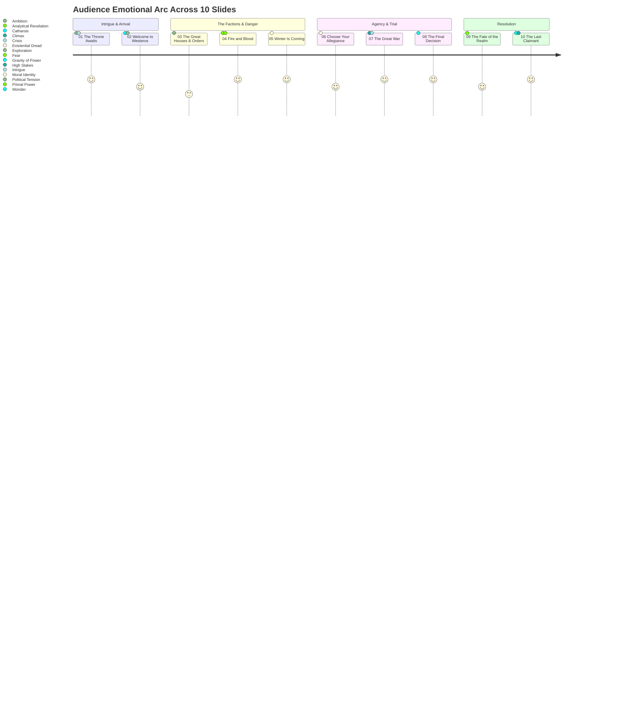

# Product Requirements Document (PRD)
## Game of Thrones — The Last Claimant (משחקי הכס — הטוען האחרון לכתר)

**Document Version:** 1.2.0 (Source-aligned implementation review)  
**Project Name:** Game of Thrones — The Last Claimant  
**Working Directory:** Directory containing `index.html`, `PRD.md`, and `build_data.py` (the Windows path in the script header is historical)  
**Presentation Target:** `index.html` (Single-file application with external library and font dependencies)  
**Repository:** [https://github.com/sspirogan/game-of-thrones](https://github.com/sspirogan/game-of-thrones)  
**Document Status:** Working draft aligned to supplied source; browser, accessibility, and performance acceptance remain unverified  
**Course:** Generative AI University Course Project  
**Author Roles:** Senior Product Manager, Creative Director, Technical Architect  

---

## 1. Executive Summary & Document Control

### 1.1 Document Overview
This Product Requirements Document (PRD) describes the supplied implementation of **Game of Thrones — The Last Claimant**, a university Generative AI course project. Source inspection establishes what is present in `index.html` and `build_data.py`; it does not establish browser behavior, accessibility conformance, or measured performance.

Unless explicitly labeled as a target or unfinished feature, implementation descriptions below refer to source code, not completed runtime acceptance tests. This review ran `python build_data.py --verify-only` successfully and checked inline JavaScript syntax with Node; it did not execute browser tests or change the HTML or Python script.

The audience adopts the persona of an unrecorded claimant to the Iron Throne, traveling across Westeros, navigating the lore of great houses and existential threats, confronting two high-stakes narrative dilemmas, and culminating in one of eight personalized ruling archetypes revealed at the Iron Throne.

### 1.2 Document Control & Metadata
| Field | Specification |
| :--- | :--- |
| **Product Name** | Game of Thrones — The Last Claimant |
| **Hebrew Title** | משחקי הכס — הטוען האחרון לכתר |
| **Target Deliverable** | Single `index.html` with inline HTML/CSS/JavaScript/SVG and generated data; external Three.js and Google Fonts requests |
| **Display Language** | Hebrew (`he-IL`) with comprehensive Right-to-Left (RTL) and Bi-directional (BiDi) text support |
| **Target Slide Count** | Exactly 10 slides (Fixed, no more and no fewer) |
| **3D Engine** | Three.js r128 pinned on cdnjs; independent CSS fallback for missing Three.js or unavailable/lost WebGL |
| **Build & Tooling** | Python 3 standard-library offline data generation and validation; no enforced minimum version or runtime backend |
| **VCS Strategy** | Historical milestone plan in Section 18; repository history and tags not verified from the uploaded files |

---

## 2. Project Overview & Background

### 2.1 Academic Context
This project represents a synthesis of Generative AI workflows, advanced front-end creative engineering, and algorithmic storytelling. Developed for a university Generative AI curriculum, the project exemplifies how generative AI tools assist across the full product lifecycle: ideation, narrative design, data structuring, 3D math formulation, code scaffolding, localization auditing, and technical documentation.

### 2.2 Baseline State vs. Target State
* **Current Source State:** Ten DOM slide sections, inline SVG illustrations and heraldry, a procedural Three.js background, navigation, a three-question quiz, four doctrine choices, metrics, eight ending records, and restart logic are present.
* **Unverified Targets:** Stable 60 FPS, cross-browser compatibility, visual quality, and complete Hebrew/BiDi correctness require measured or manual tests. They are not acceptance results established by this document.

### 2.3 Core Value Proposition
Traditional digital presentations are passive, linear, and text-heavy. **The Last Claimant** replaces static slides with an interactive theatrical journey. By putting the user directly into the Westerosi political struggle as an active protagonist whose choices dictate the fate of the realm, the application bridges the gap between educational web presentations, cinematic gaming, and interactive digital fiction.

---

## 3. Product Vision, Pillars & Strategic Goals

### 3.1 Vision Statement
> *"To transport the user into the fractured realm of Westeros as the forgotten heir to the Iron Throne, delivering an extraordinary, cinematic interactive presentation where cutting-edge 3D visuals, authentic dark-fantasy storytelling, and algorithmic audience agency converge into an unforgettable personalized coronation."*

### 3.2 The Four Product Pillars
1. **Cinematic Dark-Fantasy Immersion:** Dark panels, gold/fire/ice accents, inline illustrations, procedural backgrounds, and active-slide-only Three.js visibility. Current transitions use a 0.7s DOM animation and frame-based camera interpolation, not scheduled 1.2–5s cinematic sequences.
2. **Audience Agency & Branching Storyline:** The narrative is non-passive. The audience faces a fully specified 3-question house affiliation quiz with deterministic tie-breaking and a strategic governance decision, mapped deterministically to 8 unique ruling archetypes and realm survival outcomes.
3. **Hebrew & RTL Localization:** Hebrew-first content, `lang="he"` / `dir="rtl"`, numeric isolation, and `<bdi>` for mixed-script text are present. Full visual localization quality remains unverified.
4. **Single-File Architecture:** Application code, data, and artwork are inline with no runtime backend. Direct-file and static-host viewing are intended; Three.js and custom fonts require network access unless cached, with CSS/system-font fallbacks.

### 3.3 Measurable Product Goals
* **P0-1:** Exactly 10 distinct, fully articulated slides with continuous navigation.
* **P0-2 (Unverified):** Zero runtime console errors across modern Chromium, Gecko, and WebKit browsers.
* **P0-3 (Unverified):** Stable 60 FPS performance on standard laptop hardware (Intel Iris / Apple M-series / dedicated GPUs).
* **P0-4 (Unverified):** Correct Hebrew RTL layout and mixed-script punctuation across all slides.
* **P0-5 (Partially verified):** Python checks all 16 faction/doctrine combinations and 64 quiz paths for bounds, valid winners, and reachability of all eight archetypes. Browser parity and thematic coherence are separate, unverified checks; this is not 100% application test coverage.

---

## 4. Target Audience & Presentation Experience

### 4.1 Target Personas
```
┌────────────────────────────────────────────────────────────────────────┐
│                        TARGET AUDIENCE PERSONAS                        │
├───────────────────────────┬──────────────────────────┬─────────────────┤
│ Academic Evaluator        │ Lore Enthusiast          │ Creative Tech   │
│ (Course Professor/TAs)    │ (Westeros Fan)           │ Evaluator       │
├───────────────────────────┼──────────────────────────┼─────────────────┤
│ • Evaluates technical     │ • Expects canonical tone │ • Evaluates UI, │
│   depth, architecture,    │   and thematic depth     │   Three.js FX,  │
│   and AI pipeline use.    │ • Demands authentic      │   performance,  │
│ • Focus on code hygiene   │   Hebrew terminology     │   typography,   │
│   and single-file design. │ • Engages with moral     │   and smooth    │
│                           │   dilemmas.              │   transitions.  │
└───────────────────────────┴──────────────────────────┴─────────────────┘
```

### 4.2 Audience Emotional Journey Arc
The 10-slide experience is orchestrated along a classic 7-stage dramatic arc:



---

## 5. Creative Concept & Narrative Framework

### 5.1 Narrative Premise
The year is uncertain; the Great War looms or has left the kingdoms fractured. The Iron Throne stands vacant. Ancient bloodlines whisper of a forgotten claimant—neither wholly of fire nor wholly of ice—who emerges from obscurity. As this claimant steps onto Westerosi soil, the realm’s advisors, maesters, and warlords demand to know: **Who are you, where do your loyalties reside, and how will you rule when the ash settles?**

### 5.2 Aesthetic Direction & Color Palette
The visual theme is **Luxurious Dark-Fantasy**, characterized by deep obsidian backgrounds, burnished gold accents, incandescent dragonfire, and bone-chilling glacial blues.

```
┌──────────────────────────────────────────────────────────────────────────┐
│                           COLOR PALETTE SPECIFICATION                    │
├──────────────────────┬─────────────┬─────────────────────────────────────┤
│ Color Name           │ Hex Code    │ Thematic Application                │
├──────────────────────┼─────────────┼─────────────────────────────────────┤
│ Obsidian Void        │ #07070A     │ Deep canvas base, vignette borders  │
│ Valyrian Charcoal    │ #111219     │ Card containers, glassmorphism UI   │
│ Aged Dragon Gold     │ #D4AF37     │ Primary headings, crowns, borders   │
│ Burnished Gold       │ #C5A059     │ Body accents, navigation hovers     │
│ Wild Dragonfire      │ #FF5722     │ Fire particles, Targaryen embers    │
│ Glacial Ice Blue     │ #00E5FF     │ Winter blizzard, Stark & Wall frost │
│ Blood Raven Crimson  │ #8B0000     │ Critical warnings, conflict accents │
│ Valyrian Steel Grey  │ #A0A5AD     │ Secondary copy, subtitles           │
│ High-Parchment White │ #F5F5F0     │ High-legibility Hebrew body text    │
└──────────────────────┴─────────────┴─────────────────────────────────────┘
```

### 5.3 Narrative Voice & Hebrew Register
All textual content presented to the audience must be in high-register literary Hebrew (עברית ספרותית-דרמטית), reminiscent of classical fantasy epics and historical chronicles. It avoids modern colloquialisms in favor of formal cadence:
* *Do not write:* "בואו נראה איזה בית מתאים לך" (Let's see which house fits you).
* *Write:* "הגורל אינו שואל — הוא תובע. הכרז על שבועת הדם שלך." (Fate does not ask — it demands. Proclaim your blood oath.)

---

## 6. Scope, Non-Goals & Boundary Conditions

### 6.1 Feature Scope Classification

| Category | In-Scope (Mandatory P0) | In-Scope (Optional Enhancements P1/P2) | Out-of-Scope (Strict Non-Goals) |
| :--- | :--- | :--- | :--- |
| **Slide Count** | Exactly 10 slides; gated jump dots present | Custom slide jump modal (not implemented) | Adding slides 11+ or merging under 10 |
| **Language** | Hebrew-first UI & RTL layout with Latin captions/titles | Language toggle (not implemented) | Untranslated English body paragraphs |
| **3D & FX** | Three.js groups visible only for active slide | Post-processing bloom/film grain (not implemented) | Heavy external 50MB+ GLTF 3D models |
| **Interactivity**| House quiz + doctrine decision | Audio atmospheric synthesizer (not implemented) | Full real-time multiplayer networking |
| **Delivery** | Single `index.html` with embedded SVG heraldry and illustrated scenes | Additional artwork (not implemented) | Multi-page routing, Webpack/Vite bundlers |
| **Backend** | Zero backend; offline Python pipeline with validation suite | Browser automation tests (not supplied) | Runtime Node.js / Flask / Django server |

### 6.2 Technical Constraints & Boundaries
1. **Single-File Encapsulation:** The production deliverable must be completely contained in `index.html`. CSS must reside in `<style>`, logic in `<script>`, and icons/assets inlined (SVG/CSS/procedural). The only permissible external network requests are the Three.js library from an established CDN and typography from Google Fonts.
2. **Zero Backend Runtime:** No active Python or database server may run during presentation. Python's role is strictly offline preprocessing, validation, and safe comment-boundary data injection.
3. **Repository Preservation:** The listed repository is historical project metadata, not verified by these uploads. This documentation-only update must not change other project files, commit, or push; the uploaded directory contains no Git metadata.

---

## 7. Detailed Slide-by-Slide Specifications (Exactly 10 Slides)

### Slide 01 — The Throne Awaits (הכס ממתין)
* **Slide ID:** `slide-01`
* **Narrative Goal:** Establish epic dark-fantasy tone, present the Iron Throne, and invite the user into the claimant role.
* **Hebrew Content Blueprint:**
  * **Title:** הטוען האחרון לכתר (The Last Claimant)
  * **Eyebrow:** `The Iron Throne Awaits`.
  * **Body:** שבע הממלכות קרועות. כס הברזל עומד שומם — האם דמך ראוי לכתר?
  * **Call to Action (CTA):** תבע את הכס וצעד קדימה. An optional oath drawer and three theme badges accompany the inline SVG throne.
* **3D Scene Specification:**
  * **Scene Layer Group:** `ThreeSceneManager.groups[1]`.
  * **Meshes/Procedural Geometry:** Arrayed cylinder blades and golden point motes; the foreground throne is inline SVG.
  * **Lighting:** Shared ambient, golden spotlight, and elemental point light. Volumetric shadows and perimeter torchlight are not implemented.
  * **Camera:** Shared interpolation toward slide waypoints; a timed 3.0-second entry is not implemented.
* **Interactions:** CTA advances to Slide 02; the oath button toggles `drawer-s01`. Keyboard navigation follows `FR-NAV-02`.

---

### Slide 02 — Tactical Realm Map (מפת שבע הממלכות)
* **Slide ID:** `slide-02`
* **Narrative Goal:** Introduce the continent of Westeros, its geographical vastness, and its strategic realms.
* **Hebrew Content Blueprint:**
  * **Title:** מפת שבע הממלכות.
  * **Subtitle:** לוח השחמט של וסטרוז — לחץ על חבל ארץ לחשיפת מאזן הכוחות.
  * **Content:** Inline SVG continent with five selectable pins: North, Riverlands, Reach, Dorne, and King's Landing. A persistent adjacent card shows region name, badge, lore, sigil, army text, and meter from `GAME_DATA.regions`.
* **3D Scene Specification:**
  * **Scene Layer Group:** `ThreeSceneManager.groups[2]`.
  * **Geometry:** Blue map-like point field behind the DOM SVG; no rotating terrain relief or geographic 3D marker picking is implemented.
* **Interactions & Touch/Mobile Handling:** Clicking/tapping a pin or activating its button role updates the same card and selected state. Hover changes styling only; a mobile overlay and explicit close button are not implemented.

---

### Slide 03 — The Great Houses & Order (הבתים הגדולים ומסדר המשמר)
* **Slide ID:** `slide-03`
* **Narrative Goal:** Explore nine house profiles and the separate Night's Watch order. This lore gallery does not select quiz allegiance and is distinct from the four playable factions.
* **Hebrew Content Blueprint:**
  * **Title:** הבתים הגדולים ומסדר המשמר.
  * **Subtitle:** תשע שושלות אצולה ומסדר עצמאי אחד — בחר סמל לחשיפת שבועת הדם.
  * **Content Matrix:**
    1. **בית סטארק (<bdi>House Stark</bdi>):** "החורף מתקרב" — כבוד, חוסן ונאמנות בלתי מתפשרת.
    2. **בית טארגאריין (<bdi>House Targaryen</bdi>):** "אש ודם" — עוצמה מוחלטת, דרקונים ומורשת ואליריאנית.
    3. **בית לאניסטר (<bdi>House Lannister</bdi>):** "שמעו את שאגתי!" — עושר חסר גבולות, עורמה ותחכום פוליטי.
    4. **Baratheon:** Storm's End; "שלנו הוא הזעם".
    5. **Greyjoy:** Pyke; "איננו זורעים".
    6. **Tyrell:** Highgarden; "גדלים בעוצמה".
    7. **Martell:** Sunspear; "בלתי מורכן, בלתי מנוצח".
    8. **Tully:** Riverrun; "משפחה, חובה, כבוד".
    9. **Arryn:** The Eyrie; "גבוה ככבוד".
  * **Separate Order:** Night's Watch at Castle Black appears on its own pedestal, not as a tenth noble house. `GAME_DATA.nineHouses` nevertheless contains ten records, including `watch`, whereas `GAME_DATA.houses` contains only the four playable affiliations: Targaryen, Stark, Lannister, and Watch.
* **3D Scene Specification:**
  * **Scene Layer Group:** `ThreeSceneManager.groups[3]`.
  * **Geometry:** A decorative gold torus. The nine heraldic tiles and Watch pedestal use inline SVG, not floating 3D shields.
* **Interactions:** Selecting a gallery item updates the active highlight, motto, and short description in the shared spotlight box. Center-stage shield animation and expanded strengths/weaknesses are not implemented.

---

### Slide 04 — Fire and Blood (אש ודם)
* **Slide ID:** `slide-04`
* **Narrative Goal:** Highlight the draconic fury of House Targaryen, the danger of absolute power, and the element of Fire.
* **Hebrew Content Blueprint:**
  * **Title:** אש ודם — עוצמת הדרקונים (Fire and Blood — The Power of Dragons)
  * **Content:** Inline SVG winged dragon, `BALERION // DROGON // DRACARYS` caption, flame percentage, slider, and three preset buttons.
  * **Thematic Quote:** "אש אינה מבחינה בין צדיק לרשע; היא רק דורשת לבעור."
* **3D Scene Specification:**
  * **Scene Layer Group:** `ThreeSceneManager.groups[4]`.
  * **Geometry:** 1,200 fire particles with additive blending; the dragon is foreground SVG, not an animated 3D silhouette.
  * **Lighting:** Elemental point-light intensity follows flame value with sine-based flicker during normal animation. Noise-driven color changes and timed camera sweeps are not implemented.
* **Interactions:** `flame-slider` ranges from 20 to 100, defaults to 65, and updates readout, particle speed, and light intensity. Presets set 30, 70, and 100; reduced-motion behavior is specified in Section 15.2.

---

### Slide 05 — Winter Is Coming (החורף מתקרב)
* **Slide ID:** `slide-05`
* **Narrative Goal:** Introduce the existential terror of the Far North, the Wall, the Others, and the element of Ice.
* **Hebrew Content Blueprint:**
  * **Title:** החורף מתקרב — מעבר לחומה.
  * **Content:** Wall-stat panel, `white-walker-eyes` / `walker-eye` DOM elements, threat text, and a button revealing a hidden prophecy drawer. Dedicated styling for those eye classes is absent; the intended eye visual is unfinished rather than a verified illustration.
* **3D Scene Specification:**
  * **Scene Layer Group:** `ThreeSceneManager.groups[5]`.
  * **Geometry:** Textured box wall with vertical ridges and 1,200 snow particles drifting left and down. Textures are generated locally on canvas.
  * **Lighting:** Cyan elemental light and reduced royal spotlight intensity; no distant blue-eye 3D lights are implemented.
* **Interactions:** `toggleFrost()` toggles `frost-runes-drawer`, button text, and `aria-expanded`. It is a DOM reveal, not a canvas wipe, drag gesture, or change to snow density.

---

### Slide 06 — Choose Your Allegiance [DECISION 1] (בחר את נאמנותך)
* **Slide ID:** `slide-06`
* **Narrative Goal:** Execute the first major interactive mechanic: a psychological 3-question house affiliation quiz determining the claimant's initial faction allegiance with deterministic tie-breaking.
* **Hebrew Content Blueprint:**
  * **Title:** מבחן הנאמנות — בחר בני ברית.
  * **Content:** Question title, step label, prompt, four answer cards, and a result bar. The questions below specify the scoring semantics; exact rendered wording comes from `GAME_DATA.quizQuestions`.
  * **Question 1 (משבר המצור — Crisis of Siege):**
    * *פתיח:* האויב צר על חומותיך בעוד אנשיך רעבים. כיצד תפעל?
    * *אפשרות א':* שורף את קווי האספקה שלו באש חסרת רחמים. (`targaryen`: +3, `stark`: 0, `lannister`: 0, `watch`: 0)
    * *אפשרות ב':* מוביל פשיטת לילה אמיצה ומגן על החלשים בגופי. (`stark`: +3, `targaryen`: 0, `lannister`: 0, `watch`: 0)
    * *אפשרות ג':* משלם לצי שכירי חרב שיתקוף את עורפו של האויב. (`lannister`: +3, `targaryen`: 0, `stark`: 0, `watch`: 0)
    * *אפשרות ד':* מחזיק מעמד בחומות ומקריב הכול למען המשמר. (`watch`: +3, `targaryen`: 0, `stark`: 0, `lannister`: 0)
  * **Question 2 (צדק מול תועלת פוליטית — Justice vs Political Expediency):**
    * *פתיח:* לורד רב-השפעה בגד בשבועת האמונים שלו, אך צבאו נחוץ למלחמה הקרבה. מה דינו?
    * *אפשרות א':* כורת את ראשו בו במקום; הדין והכבוד עומדים מעל לכל תועלת. (`stark`: +3)
    * *אפשרות ב':* מאיים עליו בדרקונים ומאלץ אותו להישבע מחדש בשבועת דם. (`targaryen`: +3)
    * *אפשרות ג':* מוחל לו תמורת מס זהב כבד ובני ערובה שיבטיחו את ציותו. (`lannister`: +3)
    * *אפשרות ד':* שולח אותו לגלות נצחית אל החומה, ללא תואר וללא אדמה. (`watch`: +3)
  * **Question 3 (ההקרבה העליונה — The Ultimate Sacrifice):**
    * *פתיח:* שמועות על אימה עתיקה מגיעות מן הצפון הקפוא. הממלכה מפולגת ועייפה. במה תשקיע את שארית כוחותיך?
    * *אפשרות א':* מגייס את כל מסדרי הממלכה ומבצר את החומה; האיום הקיומי קודם לכל כתר. (`watch`: +3)
    * *אפשרות ב':* רותם את אש הדרקונים והידע הואליריאני להשמדת האויב העל-טבעי. (`targaryen`: +3)
    * *אפשרות ג':* מאחד את צבאות הצפון במסדר כבוד ומגן על עמי וסטרוז בחרב פלדה. (`stark`: +3)
    * *אפשרות ד':* מממן קווי אספקה ומבצרי אבן עורפיים; כסף ומשאבים מנצחים מלחמות. (`lannister`: +3)
* **Deterministic Tie-Breaking Engine:**
  If the highest scores tie (with three required answers, the reachable tie is 3-3-3-0):
  1. **Primary Tie-Breaker:** The faction chosen in **Question 3** (The Ultimate Sacrifice) takes immediate precedence, as it reflects the claimant's existential worldview.
  2. **Secondary Tie-Breaker:** If Question 3 was not one of the tied factions, the faction selected in **Question 2** breaks the tie.
  3. **Canonical Hierarchy (Tertiary Fallback):** In the mathematically unreachable event of an unresolvable cycle, canonical lineage breaks the tie: `Targaryen > Stark > Lannister > Night's Watch`.
* **3D Scene Specification:**
  * **Scene Layer Group:** `ThreeSceneManager.groups[6]`.
  * **Geometry:** Four translucent gold cones. Live faction-colored light feedback and an interactive 3D pedestal are not implemented.
* **Interactions & Gating:** Picking an answer immediately advances to the next question; the third answer resolves `AppState.decision1_faction` and unlocks slides 07–08. The result is not immutable: the final question's cards remain available and can recompute allegiance. No previous-question editor or explicit confirmation step is implemented.

---

### Slide 07 — The Great War (המלחמה הגדולה)
* **Slide ID:** `slide-07`
* **Narrative Goal:** Depict the catastrophic clash between Fire and Ice, testing the claimant's strategic readiness for what ruling entails.
* **Hebrew Content Blueprint:**
  * **Title:** המלחמה הגדולה — התנגשות האש והקרח (The Great War — Clash of Fire and Ice)
  * **Content:** Inline SVG battlefield panorama, faction-specific banner and advantage text, and two selectable frontline cards.
* **3D Scene Specification:**
  * **Scene Layer Group:** `ThreeSceneManager.groups[7]`.
  * **Geometry:** One rotating 1,000-point fire/ice-colored field; not colliding simulations with steam bursts.
  * **Lighting:** Faction-colored elemental light. A 3.5-second fly-through and explosion strobes are not implemented.
* **Interactions:** Entering the slide updates the faction banner and advantage text. `switchFront()` only changes active styling and pressed state; casualty calculations, reserve inspection, and tactical simulation are unfinished/not implemented.

---

### Slide 08 — The Final Decision [DECISION 2] (ההכרעה הסופית)
* **Slide ID:** `slide-08`
* **Narrative Goal:** Present the climax dilemma: How will the claimant govern the shattered realm once victorious?
* **Hebrew Content Blueprint:**
  * **Title:** צו השלטון — איזה מנהיג תהיה?
  * **Content:** Four selectable doctrine cards; the longer descriptions below describe their themes rather than verbatim UI copy.
  * **Choice Cards (4 Distinct Doctrines):**
    1. **שליטה מוחלטת באש ובברזל (<bdi>Iron Fist & Absolute Order</bdi>):** דיכוי כל התנגדות, שלטון ריכוזי בלתי מתפשר, ופחד כערובה לשלום.
    2. **צדק עיוור ורפורמה חוקתית (<bdi>Just Law & Realm Reform</bdi>):** פירוק מוקדי הכוח הישנים, שוויון בפני החוק ומשפט הוגן לכל אזרח.
    3. **הקרבה אישית והגנת הגבולות (<bdi>Vigilant Guardian & Border Shield</bdi>):** הפניית משאבי הממלכה לביצור החומה והגנה מפני איומים קיומיים.
    4. **תחכום דיפלומטי ושגשוג כלכלי (<bdi>Pragmatic Commerce & Diplomacy</bdi>):** שיקום עורקי המסחר, בריתות כספיות ויצירת שלום דרך תלות הדדית.
* **3D Scene Specification:**
  * **Scene Layer Group:** `ThreeSceneManager.groups[8]`.
  * **Geometry:** Sparse mist point field. A ruined throne-room model, avatar, and floating 3D seals are not implemented; doctrine icons are inline SVG.
* **Interactions & State Update:** Selecting a doctrine highlights its card and wax-seal label, sets `AppState.decision2_philosophy`, and unlocks slides 09–10 once faction allegiance exists. The selection can be changed.

---

### Slide 09 — The Fate of the Realm (גורל הממלכה)
* **Slide ID:** `slide-09`
* **Narrative Goal:** Synthesize the claimant's two choices, reveal the transparent algorithmic logic of the decision engine, and compute realm survival metrics.
* **Hebrew Content Blueprint:**
  * **Title:** גורל הממלכה — מאזן הכוחות (The Fate of the Realm — Balance of Power)
  * **Content:** Three SVG radial gauges, a synthesis sentence, and a faction/metric summary badge, populated on slide entry.
  * **Metrics Dashboard (Algorithmic Output):**
    * **יציבות פוליטית (<bdi>Political Stability</bdi>):** מדד באחוזים המחושב לפי התאמת הברית לפילוסופיה.
    * **רווחת העם (<bdi>People's Prosperity</bdi>):** רמת החיים הכלכלית תחת המשטר הנבחר.
    * **מוכנות לאיומי העתיד (<bdi>Defense Readiness</bdi>):** חוסנה הצבאי של הממלכה מול איומים מעבר לים ולחומה.
  * **Summary Narrative:** A templated Hebrew sentence reports faction and the three percentages; a detailed doctrine-specific causal explanation is not implemented.
* **Algorithmic Metric Formulas:**
  The 3 metrics are dynamically calculated using the following mathematical formulas:
  1. **Political Stability:**  
     $$\text{Stability} = \text{clamp}\big(\text{BaseHouse}(\text{faction}) + \text{Mod}(\text{faction}, \text{philosophy}), 30\%, 98\%\big)$$
     * Base: Targaryen = 65%, Stark = 85%, Lannister = 80%, Watch = 75%.
     * Synergy Modifiers:
       * `iron_fist`: Targaryen (+15%), Lannister (+10%), Stark (-15%), Watch (-10%).
       * `just_law`: Stark (+15%), Watch (+10%), Lannister (+5%), Targaryen (-10%).
       * `guard`: Watch (+15%), Stark (+10%), Lannister (-5%), Targaryen (0%).
       * `commerce`: Lannister (+15%), Stark (+5%), Targaryen (0%), Watch (-15%).
  2. **People's Prosperity:**  
     $$\text{Prosperity} = \text{clamp}\big(\text{BaseHouse}(\text{faction}) + \text{PhilBonus}(\text{philosophy}), 20\%, 95\%\big)$$
     * Base: Lannister = 75%, Stark = 70%, Watch = 50%, Targaryen = 45%.
     * Philosophy Bonus: `commerce` (+25%), `just_law` (+20%), `guard` (+5%), `iron_fist` (-20%).
  3. **Defense Readiness:**  
     $$\text{Defense} = \text{clamp}\big(\text{BaseHouse}(\text{faction}) + \text{PhilBonus}(\text{philosophy}), 40\%, 99\%\big)$$
     * Base: Watch = 95%, Targaryen = 90%, Stark = 85%, Lannister = 65%.
     * Philosophy Bonus: `guard` (+25%), `iron_fist` (+15%), `just_law` (+5%), `commerce` (-15%).
* **3D Scene Specification:**
  * **Scene Layer Group:** `ThreeSceneManager.groups[9]`.
  * **Geometry:** Three rotating metallic torus rings. Inscribed glyphs and volumetric light shafts are not implemented.
* **Interactions:** Gauge text updates immediately and SVG stroke offsets transition over 1.3s normally; they do not necessarily restart at zero on re-entry. Footer navigation advances to coronation; no special grand-transition CTA is implemented.

---

### Slide 10 — The Last Claimant (הטוען האחרון לכתר)
* **Slide ID:** `slide-10`
* **Narrative Goal:** Deliver the emotional, visual, and narrative climax: coronation, personalized archetype reveal, and final realm status.
* **Hebrew Content Blueprint:**
  * **Title:** הטוען האחרון — ההכתרה (The Last Claimant — The Coronation)
  * **Content:** Inline SVG crown and dynamic Hebrew/English archetype titles, summary, and chronicle.
  * **Archetype Card:** Displays dynamic outcome based on the 8 Ruling Archetypes (e.g., שליט הדרקונים הנצחי, המגן הנשגב של הצפון, אדון הצללים והזהב).
  * **Epilogue Chronicle:** An optional drawer opened by "קרא את כרוניקת מאה השנים הבאות" displays the selected archetype's stored Hebrew `chronicle`; no century-by-century simulation is implemented.
  * **Replay Action:** Button invokes `PresentationEngine.resetClaim()` and returns to Slide 01.
* **3D Scene Specification:**
  * **Scene Layer Group:** `ThreeSceneManager.groups[10]`.
  * **Geometry:** Rotating cylindrical crown base and 700 golden rain points.
  * **Lighting:** Shared lights with gold elemental color. Restored hall, banners, god-rays, and a timed 4–5s ascent are not implemented.
* **Interactions & Replay Behavior:**
  * The source resets scores, answers, faction, doctrine, metrics, flame (65), frost, lore drawers, region (North), gallery spotlight (Stark), first battle front, quiz step, and dynamic ending text. It clears selection styles, hides the result/toast, and relocks gated destinations.
  * **Replay Camera Behavior:** A 400ms fade-to-black precedes the reset and direct camera snap; a further 400ms fade-in/input lock completes the approximately 0.8s replay. A timer prevents duplicate replay requests. This does not regenerate particle coordinates or reload dependencies; see Section 15.2 for reduced motion.

---

## 8. User Journey & Interactive Decision Engine

### 8.1 The Two-Stage Decision Architecture
The presentation integrates two critical audience interaction checkpoints:
1. **Decision 1 (Slide 06):** House Affiliation Quiz resolves to one of four playable affiliations (`targaryen`, `stark`, `lannister`, `watch`) using deterministic tie-breaking. These four are not the nine-house lore gallery plus its separate Watch pedestal.
2. **Decision 2 (Slide 08):** Mandate of Rule resolves to one of four philosophies (`iron_fist`, `just_law`, `guard`, `commerce`).

### 8.2 Combinatorial Matrix to 8 Archetypes
The 16 raw combinatorial states ($4 \times 4$) are deterministically mapped to **8 Canonical Ruling Archetypes**, resolving all thematic inconsistencies:

```
                              [ DECISION 1: FACTION ]
                    ┌──────────────┬──────────────┬──────────────┬──────────────┐
                    │  TARGARYEN   │    STARK     │  LANNISTER   │ NIGHT'S WATCH│
┌───────────────────┼──────────────┼──────────────┼──────────────┼──────────────┤
│ 1. Iron Fist      │ ARC-01       │ ARC-06       │ ARC-06       │ ARC-06       │
├───────────────────┼──────────────┼──────────────┼──────────────┼──────────────┤
│ 2. Just Law       │ ARC-08       │ ARC-02       │ ARC-05       │ ARC-04       │
├───────────────────┼──────────────┼──────────────┼──────────────┼──────────────┤
│ 3. Vigilant Guard │ ARC-07       │ ARC-04       │ ARC-08       │ ARC-04       │
├───────────────────┼──────────────┼──────────────┼──────────────┼──────────────┤
│ 4. Pragmatic Comm │ ARC-08       │ ARC-05       │ ARC-03       │ ARC-08       │
└───────────────────┴──────────────┴──────────────┴──────────────┴──────────────┘
```

### 8.3 The 8 Canonical Ruling Archetypes Specification

| ID | Archetype Title (Hebrew & English) | Associated House + Philosophy Matrix | Narrative Outcome Summary (Hebrew) |
| :--- | :--- | :--- | :--- |
| **ARC-01** | **שליט הדרקונים הנצחי**<br>*(The Eternal Dragon Sovereign)* | Targaryen + Iron Fist | שליטה מוחלטת בכוח האש. הממלכה מאוחדת תחת מורא כבד, מרידות מדוכאות באיבן, ושבע הממלכות חוות שלום של צייתנות מוחלטת. |
| **ARC-02** | **המלך החוקק של הצפון**<br>*(The Lawgiver of the North)* | Stark + Just Law | עידן של צדק ויושרה. חוקי הממלכה שווים לכל נפש, השחיתות נעקרת, ושמך נזכר לדורות כמגן החלשים וההוגן במלכים. |
| **ARC-03** | **אדון הצללים והזהב**<br>*(The Lord of Shadows and Gold)* | Lannister + Commerce | כס הברזל הופך למרכז הכלכלי של העולם הידוע. בריתות נרכשות בזהב, אויבים מנוטרלים בחשאי, ושגשוג חסר תקדים שוטף את וסטרוז. |
| **ARC-04** | **מגן האנושות הנשגב**<br>(The Sovereign Shield of the Living) | Watch + Just Law or Guard; Stark + Guard | כל עוצמת הממלכה מופנית צפונה. החומה מבוצרת במבצרי גרניט, משמר הלילה הופך לצבא העילית של הממלכה, והחשכה נהדפת לתמיד. |
| **ARC-05** | **הבורר הצודק של שבע הממלכות**<br>(The Just Arbitrator) | Lannister + Just Law; Stark + Commerce | יצירת מועצה עליונה משותפת לכל הבתים. שלטון פדרלי חכם המאזן בין כוח האצולה לזכויות העם הפשוט, תוך צמצום החיכוך המעמדי. |
| **ARC-06** | **רודן הברזל והאפר**<br>*(The Ashen Tyrant / Lord of the Bastion)* | Lannister / Stark / Watch + Iron Fist | סדר אכזרי המושג בגרדומים ובחומות ברזל. הפחד מגן על וסטרוז מפני כאוס חיצוני, אך המחיר הוא שממה רוחנית ושנאה רוחשת בצללים. |
| **ARC-07** | **שומר הסודות והכשף**<br>(The Mystic Warden) | Targaryen + Guard | תחיית הקסם העתיק בוסטרוז. ידע ואליריאני עמוק ולחשי מגן משתלבים להגנה על הממלכה מפני כוחות קוסמיים בלתי נתפסים. |
| **ARC-08** | **משקם ההריסות הפרגמטי**<br>(The Pragmatic Restorer) | Targaryen + Just Law or Commerce; Lannister + Guard; Watch + Commerce | בנייה מחדש סבלנית של הערים החרבות, פתיחת נתיבי סחר עם אסוס, ופיוס הדרגתי בין כל הבתים המסוכסכים. |

### 8.4 Decision Flowchart
```mermaid
flowchart TD
    S01["Slide 01: The Throne Awaits"] --> S02["Slide 02: Tactical Realm Map"]
    S02 --> S03["Slide 03: The Great Houses & Orders"]
    S03 --> S04["Slide 04: Fire and Blood"]
    S04 --> S05["Slide 05: Winter Is Coming"]
    S05 --> S06["Slide 06: DECISION 1<br>(House Affiliation Quiz - 3 Questions)"]
    
    S06 -->|Targaryen / Stark / Lannister / Watch| S07["Slide 07: The Great War"]
    S07 --> S08["Slide 08: DECISION 2<br>(Mandate of Rule)"]
    
    S08 -->|Iron Fist / Just Law / Guard / Commerce| S09["Slide 09: The Fate of the Realm<br>(Algorithmic Engine & Metrics)"]
    S09 --> S10["Slide 10: DECISION REVEAL<br>(Coronation: 1 of 8 Archetypes)"]
    S10 -->|Replay Action (Fast 0.8s Reset)| S01
```

---

## 9. Functional Requirements

### 9.1 Presentation Navigation System
* **FR-NAV-01 (Dual Controls):** The presentation must provide both on-screen clickable buttons (קדימה / הבא and אחורה / הקודם) and full keyboard navigation.
* **FR-NAV-02 (RTL Directional Logic):** In Hebrew RTL mode:
  * Forward navigation (Advance) must trigger via: Left Arrow key (`ArrowLeft`), Spacebar, Page Down, or the on-screen "הבא / קדימה" button.
  * Backward navigation (Previous) must trigger via: Right Arrow key (`ArrowRight`), Page Up, or the on-screen "הקודם" button.
* **FR-NAV-03 (Direct Jump Keys & Decision Gate Protection):**
  * Pressing number keys `1` through `6` jumps directly to slides 01 through 06.
  * Pressing number keys `7` through `0` (Slide 10) is **strictly locked** until the prerequisite decision gates are cleared:
    * Key `7` and `8` remain locked until Slide 06 resolves a faction; the result is not immutable.
    * Key `9` and `0` remain locked until Slide 08 (Decision 2) is chosen.
  * Pressing a locked key displays a subtle Hebrew toast notification:  
    `"עליך להכריע בבחירה זו לפני שתוכל לחזות בעתיד הממלכה"`  
    and prevents any state de-synchronization or null-pointer crashes.
* **FR-NAV-04 (Slide Counter with Numeric Isolation):** A fixed, persistent slide counter must display the current position in Hebrew format with strict numeric directional tags to prevent RTL number flipping:  
  `שקופית <span dir="ltr">04</span> מתוך <span dir="ltr">10</span>` (Slide 04 of 10).
* **FR-NAV-05 (Progress Indicator):** The existing top-edge `#progress-bar` shows slide position using `(currentSlide - 1) / 9 * 100%`: 0% on slide 01 and 100% on slide 10. It updates on direct jumps, back navigation, and restart; it is not a visited-slide or task-completion metric. The implementation is a visual div without `role="progressbar"` or ARIA value attributes; semantic progress exposure is unfinished and must be tested if added.
* **FR-NAV-06 (Transition Input Lock):**
  * Navigation is ignored while `AppState.isTransitioning` is true, normally for 600ms after a slide change. The DOM transition lasts 0.7s; this lock is not tied to camera arrival.
  * After the lock ends, another slide change retargets frame-based camera interpolation. There is no scheduled long tween or explicit smooth fast-forward mechanism.
  * Instant transitions bypass the delay; the existing reduced-motion requirement in Section 15.2 defines motion behavior.
* **FR-NAV-07 (Jump Dots & Touch):** Ten focusable jump dots use the same prerequisite checks as number keys and Next. A predominantly horizontal swipe over 55px moves left to advance and right to go back; swipes starting on inputs, buttons, custom button-role controls, or lore drawers are ignored. **Local HTML discrepancy:** No `touchmove` handler is present, so vertical scrolling does not cancel slide navigation during `touchmove`. The current implementation checks only the final displacement at `touchend` (`abs(dx) > 55` and `abs(dx) > abs(dy) * 1.5`); vertical-scroll cancellation during the gesture is not implemented.
* **FR-NAV-08 (Input & Boundaries):** Global shortcuts ignore editable controls, modifier chords, and handled events; Space on a button activates that control rather than also advancing. Previous is disabled at slide 01 and Next at slide 10; gated Next attempts show a Hebrew alert rather than disabling the button. The brand returns to slide 01 without resetting choices.

### 9.2 State Management Engine
* **FR-STATE-01 (In-Memory Store):** All user choices, active slide index, quiz scores, and calculated outcomes must be stored in a centralized JavaScript state object:
```javascript
const AppState = {
  currentSlide: 1,
  totalSlides: 10,
  decision1_scores: { targaryen: 0, stark: 0, lannister: 0, watch: 0 },
  decision1_answers: [null, null, null], // Recorded option per question
  decision1_faction: null,      // 'targaryen' | 'stark' | 'lannister' | 'watch'
  decision2_philosophy: null,   // 'iron_fist' | 'just_law' | 'guard' | 'commerce'
  outcome: {
    archetypeId: null,
    stability: 0,
    prosperity: 0,
    defense: 0
  },
  isTransitioning: false,
  flameIntensity: 65,
  frostWiped: false,
  webglAvailable: false
};
```
* **FR-STATE-02 (State Reset):** `resetClaim()` restores the state and UI defaults listed for Slide 10, returns directly to slide 01, snaps the camera, and relocks gates. Normal replay uses two 400ms phases; reduced-motion handling is defined in Section 15.2. Repeat requests are guarded during replay.
* **FR-STATE-03 (State Limits):** State is in memory only, without storage persistence. Slide 09 overwrites `outcome` with the three metric fields; Slide 10 renders the selected archetype directly and does not store its ID/title/chronicle in `outcome`. Gallery/front selection is held in DOM classes, not fully in `AppState`; live downstream refresh while changing earlier decisions is not implemented.

---

## 10. Visual Design, Typography & Animation System

### 10.1 Typography Hierarchy
Typography must be imported via Google Fonts with zero local asset dependencies:
1. **Primary Hebrew Display & Headings:** `Frank Ruhl Libre` (serif) or `Cinzel Decorative` (with Latin fallback) — dramatic, royal, and evocative.
2. **Body & Interactive Hebrew Text:** `Heebo` with system sans-serif fallbacks; imported weights are 300, 400, 500, 600, and 700. `Assistant` is not requested.
3. **Monospace & Stat Metrics:** `Courier Prime`; royal Latin text uses `Cinzel Decorative` / `Cinzel`. The Google Fonts request also includes Frank Ruhl Libre 500/700/900, Cinzel 600/700/900, Cinzel Decorative 700/900, and Courier Prime 400/700.

```css
/* Typography Tokens */
--font-display: 'Frank Ruhl Libre', 'Cinzel', serif;
--font-royal: 'Cinzel Decorative', 'Cinzel', serif;
--font-body: 'Heebo', -apple-system, BlinkMacSystemFont, "Segoe UI", Roboto, sans-serif;
--font-mono: 'Courier Prime', monospace;
```

### 10.2 Dark-Fantasy UI Styling & Glassmorphism
* **Containers:** High-end dark glassmorphism:
  ```css
  background: rgba(18, 19, 26, 0.75);
  backdrop-filter: blur(12px);
  -webkit-backdrop-filter: blur(12px);
  border: 1px solid rgba(212, 175, 55, 0.25);
  box-shadow: 0 8px 32px 0 rgba(0, 0, 0, 0.8), inset 0 0 16px rgba(212, 175, 55, 0.05);
  ```
* **Dividers & Filigree:** Subtle gold leaf lines (`linear-gradient(90deg, transparent, #D4AF37, transparent)`).
* **Hover Micro-interactions:** Gold glow border animations, slight translateY (-2px), and box-shadow pulses.

---

## 11. Three.js Architecture & Continuous 3D Animation Behavior

### 11.1 Canvas & Scene Graph Layer Architecture
* **Canvas:** One full-viewport `#bg-canvas` at z-index 1 sits behind a vignette at 2 and `#presentation-app` at 10. It is decorative and marked `aria-hidden="true"`.
* **Groups:** All ten groups are constructed and stored as `ThreeSceneManager.groups[1]` through `groups[10]`; the descriptive `groupThrone` / `groupMap` names in the earlier design are not implementation identifiers.
* **Active-slide-only visibility:** `updateVisibleLayers(activeSlide)` sets each group's visibility to `i === activeSlide`. Only the active slide's Three.js group is visible, including during transitions; adjacent groups are not shown. This is visibility-based selection, not unloading or camera-frustum-based resource disposal.
* **Update culling:** Animated systems on slides 01, 04, 05, 07, 09, and 10 check their group's visibility before changing buffers/rotation. Hidden groups remain allocated. No measured sub-12ms frame budget or 60 FPS result is established.

### 11.2 Camera Transitions vs. Continuous Ambient Motion
* **DOM transitions:** Slide opacity, transform, and visibility use `--trans-cinema: 0.7s cubic-bezier(0.2, 0.9, 0.25, 1)`. Current and target DOM classes change together, while UI counters and position update immediately.
* **Camera:** Each normal animation frame moves camera x/y/z and rotation-x by 5% of the remaining distance to the active slide's waypoint. This is frame-rate-dependent interpolation, not a duration-controlled tween; the earlier 1.2–1.8s standard and 3–5s landmark sequences are not implemented.
* **Ambient loops:** Normal mode schedules `requestAnimationFrame` and animates active motes, fire, snow, battlefield points, astrolabe rings, or gold rain/crown. Some backgrounds are static. Frame scheduling is not a guaranteed frame rate.
* **Exceptions:** Context loss cancels the animation loop; reduced-motion handling is specified once in Section 15.2. Restart snaps to slide 01 rather than traversing intermediate waypoints.

### 11.3 Procedural Geometry & Inline Artwork
* **Meshes:** Cylinder blades, torus rings, translucent cones, a textured box wall with ridges, and a cylindrical crown base are present. Four modeled heraldic shields, displaced terrain, volumetric effects, and a ruined/restored hall are not implemented.
* **Particles:** BufferGeometry/PointsMaterial systems include 1,200 fire points, 1,200 snow points, 1,000 battlefield points, and 700 gold-rain points. Counts are fixed rather than responsive particle tiers.
* **Artwork:** Throne, map, dragon, heraldry, battlefield, and crown illustrations use inline SVG. Particle sprites and wall textures are generated on local canvas elements; no external images, GLTF/OBJ models, or texture files are loaded.

---

## 12. Python Development Pipeline & Offline Data Generation

### 12.1 Purpose & Verification Boundary
`build_data.py` uses Python 3 standard-library modules `sys`, `json`, `re`, and `pathlib` to hold canonical data, validate mathematical paths, and optionally inject a JavaScript data block. Python is an offline development tool, not a browser runtime or backend.

The script does not enforce Python 3.10+, lint Hebrew/BiDi strings, test DOM/navigation/accessibility, or run JavaScript/browser parity checks. Its printed “100% coverage” is limited to enumerated Python cases, not application coverage or narrative quality.

### 12.2 Script Responsibilities & Commands
* **Validation:** Iterate over all 16 faction/doctrine pairs, assert metric clamp ranges, and check that the matrix reaches all eight declared archetypes. Iterate over all 64 three-answer quiz permutations, assert a valid faction winner, and report faction counts; each faction resolves in 16 cases.
* **Verify only:** `python build_data.py --verify-only` runs that suite and exits without writing HTML. It does not check that existing embedded data matches the Python dictionary, that delimiters exist, or that injection succeeds.
* **Generation:** `python build_data.py` validates first, then targets `index.html` beside the script, regardless of the current working directory. It serializes `GAME_DATA` using `json.dumps(..., ensure_ascii=False, indent=2)` and regex-replaces blocks bounded by the comments below.
* **Injection boundary:** Replacement is intended to preserve markup, CSS, and logic outside the marked data block. The implementation rewrites the HTML file as UTF-8; it is not an atomic write, does not enforce exactly one delimiter pair, and is not general HTML/script-context sanitization for untrusted content.
* **Unfinished checks:** Hebrew/BiDi linting, exact expected-value assertions for all paths, embedded-data synchronization checks, injection-preservation tests, and browser parity tests are not implemented.

```javascript
/* --- PYTHON_DATA_START --- */
const GAME_DATA = { /* serialized canonical data */ };
/* --- PYTHON_DATA_END --- */
```

### 12.3 Actual Data Schema
| Key | Content and purpose |
| :--- | :--- |
| `metadata` | Hebrew/English titles, version `1.2.0`, slide count 10 |
| `houses` | Four playable faction records: `nameHe`, `nameEn`, `mottoHe`, `mottoEn`, `color`, `theme` |
| `nineHouses` | Nine noble-house profiles plus separate `watch` record (ten records); `nameHe`, `seatHe`, `mottoHe`, `descHe`, `color` |
| `regions` | Five records with `id`, `nameHe`, `badge`, `lore`, `army`, `pct`, `color` |
| `quizQuestions` | Three questions with `id`, `title`, `prompt`, and four `text` / `faction` options each |
| `doctrines` | Four records with `titleHe`, `titleEn`, `descHe` |
| `decisionMatrix` | Four factions × four doctrines mapped to ARC-01 through ARC-08 |
| `archetypes` | Eight records with `titleHe`, `titleEn`, `summary`, `chronicle`; no embedded `stats` or `epilogueHe` field |

Metrics are calculated separately in Python and JavaScript using the formulas in Section 7. Gallery structure and doctrine-card markup are inline HTML, so generating data alone does not rebuild all UI content.

### 12.4 Results of This Documentation Review
* **Passed:** `python build_data.py --verify-only` completed all 16 metric/matrix cases and 64 quiz paths, reached all eight archetypes, and did not modify HTML.
* **Warning:** The interpreter reported an invalid `\B` escape in the historical Windows-path docstring. It did not prevent validation; correcting the script is outside this documentation-only change.
* **Passed:** Inline application JavaScript passed Node syntax checking. This is not a runtime browser test.
* **Not run:** Data injection, browser walkthroughs, cross-engine testing, screen-reader/contrast testing, and performance profiling.

---

## 13. Technical Architecture & Single-File Delivery Constraints

### 13.1 Packaging & External Dependencies
The page contains CSS, inline SVG definitions/artwork, ten slide sections, persistent header/footer controls, a marked data block, `AppState`, `ThreeSceneManager`, and `PresentationEngine`. It starts the controller on `DOMContentLoaded`; no local build server, runtime Python, package manager, or database is required.

* **Three.js:** The head includes the pinned cdnjs script `https://cdnjs.cloudflare.com/ajax/libs/three.js/r128/three.min.js`. This is cdnjs, not an unversioned “official CDN” or an r128+ range; the script has no integrity attribute or alternate CDN retry.
* **Google Fonts:** Styles are requested from `https://fonts.googleapis.com` and font assets from `https://fonts.gstatic.com`, with preconnect hints. Requested families are Frank Ruhl Libre, Heebo, Cinzel, Cinzel Decorative, and Courier Prime; Section 10.1 lists weights and fallback stacks.
* **Network boundary:** The application is single-file packaged, not fully network-independent. If network access is unavailable and assets are not cached, custom fonts fall back to system fonts and missing Three.js activates CSS graphics; there is no bundled offline Three.js copy or service worker.
* **Unverified delivery:** Direct `file://` and static-host operation, offline loading, font substitution, and CDN failure timing need browser checks. The external head script is synchronous and may delay initialization while a network request is pending.

### 13.2 CDN Guard & Runtime Context Loss Safety
* **Missing library / initialization failure:** `ThreeSceneManager.init()` checks `typeof THREE === 'undefined'` and catches renderer/setup exceptions. `activateFallback()` marks WebGL unavailable, cancels pending animation, hides the canvas, and reveals the independent CSS gradient/particle-dot background.
* **Notification:** `#graphics-notice` has `role="status"` and `aria-live="polite"`; a Hebrew fallback message is shown for 6.5s. It states that slides and choices remain available in alternative graphics mode.
* **Context loss:** The `webglcontextlost` listener prevents default and activates fallback. Rendering exceptions also activate it.
* **Restoration:** The `webglcontextrestored` listener reuses the renderer/scene, restores canvas visibility, updates size/aspect and active layers, snaps the current camera, and restarts rendering; failure returns to fallback. It does not create a second scene manager or refetch the library.
* **Verification status:** Guards and listeners are present in source; successful recovery and uninterrupted interactive use are not established without browser fault-injection tests.

---

## 14. Hebrew RTL & BiDi Localization Standards

### 14.1 HTML Document Configuration
* Root declaration must specify: `<html lang="he" dir="rtl">`.
* Standard meta tags must include `<meta charset="UTF-8">`.

### 14.2 Mixed-Script BiDi Isolation Guidelines
The following are localization review requirements, not evidence of complete implementation. The source uses bdi and numeric-isolation CSS, but every mixed-script string and punctuation sequence still needs visual auditing:
1. **BiDi Isolation Tags:** Wrap all foreign words in `<bdi>` (Bi-directional Isolation) tags:
   ```html
   <p>השבועה העתיקה של בית <bdi>House Stark</bdi> מהדהדת בצפון.</p>
   ```
2. **Numeric Directional Containers:** All counters and numbers must be wrapped in `<span dir="ltr">` or isolated via CSS `unicode-bidi: isolate;` to prevent reversal in Chromium/Firefox.
3. **Directional Markers:** For inline typography containing punctuation adjacent to Latin words, insert Unicode Right-to-Left Marks (`&rlm;` / `\u200F`) to prevent trailing punctuation (periods, question marks, colons) from jumping to the wrong side of the sentence.

### 14.3 CSS RTL Rules
* Prefer CSS logical properties for future layout changes; the current stylesheet mixes logical properties with physical left/right and margin/padding rules, so full conversion is unfinished:
  * Use `margin-inline-start` / `margin-inline-end` instead of `margin-left` / `margin-right`.
  * Use `padding-inline-start` / `padding-inline-end` instead of `padding-left` / `padding-right`.
  * Text alignment defaults to `text-align: right`.

---

## 15. Usability, Accessibility & Responsive Behavior

### 15.1 Viewport Breakpoints & Responsive Behavior
* **Base layout:** Full-viewport app with header 68px, footer 72px, slides container max-width 1360px, and internally scrollable slide content. Auto margins and non-shrinking slide children aim to keep the top of overflowing content reachable.
* **At widths up to 960px:** Map, dragon, winter, clash, and frontline grids become single-column; the nine-house grid becomes three columns; doctrine cards become two columns. Header/footer padding reduces to 18px, title size reduces, and the keyboard legend is hidden.
* **At heights up to 800px:** Slide 07 spacing and battlefield panorama height are reduced. Artwork also uses viewport-relative sizes.
* **Not implemented / unverified:** Separate desktop/laptop/tablet/mobile particle budgets, guaranteed 48px targets, mobile close-button overlays, and adaptive shadow/shader quality are not implemented. Small-screen overflow, zoom/reflow, touch target size, and layouts from 375px to 4K require testing.

### 15.2 Accessibility (a11y)
These are source-level provisions and remaining requirements, not a conformance certificate. WCAG AA compliance must not be claimed without an appropriately scoped accessibility audit; keyboard, screen-reader, contrast, zoom/reflow, and motion testing remain unverified.

* **Keyboard focus:** Native buttons/inputs and custom button-role controls receive visible gold focus outlines. Initialization adds `role="button"` and `tabindex="0"` to non-button onclick controls, including map pins, gallery cards, battle fronts, and doctrines; dynamically created quiz cards and jump dots receive equivalent roles and labels.
* **Activation & editing:** Enter/Space activates custom controls, suppressing repeat activation and duplicate slide navigation. Global navigation does not steal editing keys from inputs, textareas, selects, or contenteditable elements. Slider keys remain native.
* **Slide focus management:** Active slides use `aria-hidden="false"` and `inert=false`; inactive slides use `aria-hidden="true"` and `inert=true`. Navigation resets the target's scroll position, adds `tabindex="-1"`, and focuses it without scrolling. Quiz rerender restores focus to its first option when focus was within the replaced option container; this needs assistive-technology testing.
* **Control states:** Jump dots expose `aria-current="step"` and `aria-disabled`; selection controls expose `aria-pressed`. **Local HTML discrepancy:** The three details buttons (`.optional-details-trigger`) and frost button (`#btn-wipe-frost`) do not start with `aria-expanded="false"`: the attribute is absent from their markup and is not set during initialization. Their drawers start hidden; the buttons receive `aria-expanded` after interaction and are set to `"false"` on restart. Initial collapsed-state attributes remain unfinished. Button labels are populated from visible text when absent.
* **Control relationships:** The details and frost buttons lack `aria-controls` relationships to their drawers; this remains a separate accessibility gap.
* **Announcements & decorative graphics:** Gate toast uses `role="alert"`; graphics fallback notice uses a polite live status. Decorative canvas/SVG sigils are hidden from assistive technology, while some meaningful illustrations have image roles/labels. Complete alternative-text coverage and announcements of quiz/result changes are unverified.
* **Reduced Motion:** The existing `prefers-reduced-motion: reduce` requirement applies to both CSS and Three.js. Current CSS disables animation and transitions on all elements and pseudo-elements and sets `scroll-behavior: auto`; this also suppresses fallback drift and replay-shade transitions. JavaScript detects initial preference and listens for changes, cancels any queued animation frame, snaps the camera, renders one static frame, and returns without scheduling a continuous loop or updating particles. Slide, flame, and resize changes request a static redraw; preference removal restarts normal rendering. Restart resets immediately with no 400ms timers/fade in this mode. Preference toggling, static redraws, and fallback behavior require browser verification.
* **Remaining accessibility work:** Audit contrast against actual rendered backgrounds, small 9px jump-dot targets, focus order, `inert` support, label/state accuracy, and screen-reader reading order. Semantic progress requirements and their current gap are maintained only in FR-NAV-05, not duplicated here.

---

## 16. Performance Considerations, Fallbacks & Technical Risks

### 16.1 Performance Budget (Targets, Not Measured Results)
* **Frame rate target:** 60 FPS, with 45 FPS as the earlier proposed mobile minimum. No frame profiling establishes either result.
* **CPU/GPU target:** At most 16.6ms per frame; no timing instrumentation or benchmark results are supplied.
* **Memory targets:** JavaScript heap at most 60MB and GPU texture memory at most 30MB; no memory measurements are supplied.
* **Load-time target:** Under 1.5s on a 10Mbps+ connection excluding fonts; unverified and affected by the synchronous external library request.
* **Current controls:** Only the active scene group is visible, inactive animated systems skip updates, and pixel ratio is capped at 2. All groups remain allocated; there is no device-tier particle reduction or adaptive performance controller.

### 16.2 WebGL Fallback Strategy
The implementation uses independent CSS layered gradients and repeating radial-dot drift, not externally loaded assets or floating SVG embers. Missing Three.js, renderer initialization failure, rendering failure, or WebGL context loss activates this background and a temporary Hebrew status notice; restoration behavior is detailed in Section 13.2.

The DOM slides, navigation, quiz, doctrine choices, metrics, and endings are intended to remain usable without Three.js. Visual equivalence or “100% fidelity” is not promised, and successful interaction/recovery under simulated failures remains unverified.

### 16.3 Risk Assessment Matrix
| Risk | Source-level mitigation | Remaining verification |
| :--- | :--- | :--- |
| CDN missing or delayed | Missing-THREE guard and independent CSS fallback | Block CDN; test pending request/startup delay and full interaction |
| WebGL initialization/context failure | Catch handlers, loop cancellation, fallback, restoration listener | Simulate initialization failure and context loss/restoration |
| Low-end GPU performance | Active-slide visibility and update checks, pixel-ratio cap | Profile fixed particle counts and retained scene resources |
| Hebrew mixed-script inversion | Root RTL, bdi, numeric isolation | Visual audit; Python BiDi linter is not implemented |
| Gate bypass / stale outcomes | Normal dots, number keys, and Next share prerequisite checks | Test every entry path and re-entry after changing choices; low-level `goToSlide()` itself does not enforce gates |
| Input mashing / replay overlap | 600ms navigation lock and replay timer guard | Rapid keyboard/touch/restart testing; no explicit tween fast-forward |
| Accessibility gaps | Focus handling, roles/states, inert, motion preference support | Complete audit before any WCAG AA claim |

---

## 17. Acceptance Criteria & Test Checklist

### 17.1 Acceptance Criteria & Current Evidence
| ID | Given / When / Then criterion | Evidence / status |
| :--- | :--- | :--- |
| AC-01 | Given the initial page, when inspecting slide sections, then exactly `slide-01` through `slide-10` exist; sequential navigation never reaches 11. | Ten sections present in source; browser traversal unverified |
| AC-02 | Given Hebrew/mixed-script content, when viewing every slide in target browsers, then reading order and punctuation remain correct. | Root RTL, bdi, numeric isolation present; visual audit unverified |
| AC-03 | Given direct-file or static-host loading, when opening the page, then inline code/data/artwork work without a backend, with explicit CDN/font dependencies and fallbacks. | Packaging inspected; runtime/offline operation unverified |
| AC-04 | Given missing Three.js or failed/lost WebGL, when initialization/rendering fails, then CSS graphics and a status notice appear while controls remain usable; restoration resumes the current scene. | Guards/listeners present; browser failure/recovery tests unverified |
| AC-05 | Given unlocked or gated destinations, when using buttons, keyboard, dots, or swipes, then bounds/gates apply, target focus/counter update, and FR-NAV-05 position is correct. | Controller inspected; end-to-end/input tests unverified |
| AC-06 | Given normal graphics, when switching slides, then only the active Three.js group is visible and active animated systems update, using the documented interpolation rather than timed landmark tweens. | Visibility/update code inspected; WebGL/profile tests unverified |
| AC-07 | Given gallery exploration, when selecting any of nine houses or the separate Watch pedestal, then the spotlight updates without setting playable allegiance. | Markup/data/controller inspected; runtime unverified |
| AC-08 | Given slide 06, when answering three questions, then scores add 3 per pick and deterministic tie-breaking yields one of four factions, unlocking 07–08. | 64 Python paths passed; JavaScript/browser parity unverified |
| AC-09 | Given a resolved faction, when selecting a doctrine and entering 09/10, then metrics use Section 7 formulas and the 4×4 matrix selects one of eight endings. | 16 Python combinations/bounds and eight-archetype reachability passed; browser parity unverified |
| AC-10 | Given changed state/UI, when restarting, then Slide 10 reset defaults and gates are restored, camera snaps to 01, and duplicate replay requests cannot overlap. | Reset implementation inspected; repeated replay tests unverified |
| AC-11 | Given keyboard-only or assistive-technology use, when operating all controls and navigating slides, then focus, names, states, and reading order are usable. | Accessibility provisions inspected; audit unverified; no WCAG AA claim |
| AC-12 | Given either motion preference, when loading, changing preference, navigating, resizing, or restarting, then Section 15.2 behavior applies. | CSS/JS branches inspected; runtime testing unverified |
| AC-13 | Given the Python data builder, when running `--verify-only`, then enumerated cases pass without modifying HTML; normal generation changes only intended delimiter content. | Verify-only passed; injection preservation and embedded-data synchronization unverified |
| AC-14 | Given the historical repository/milestone plan, when checking commits/tags, then actual history can be documented separately from planned labels. | No Git metadata in uploaded directory; history/tags unverified |

### 17.2 Remaining Acceptance Work
* **Interaction:** Test every slide and control, all 64 quiz paths and 16 faction/doctrine combinations leading to 8 unique endings in JavaScript, gate attempts through every normal navigation route, final-question reselection, earlier-decision changes, and repeated restart.
* **Graphics & delivery:** Exercise missing CDN, lost/restored WebGL, fallback resizing, direct-file/static hosting, unavailable fonts, and preference changes while in fallback.
* **Accessibility & layout:** Run keyboard/screen-reader/contrast/reflow checks and desktop/mobile viewport tests. Measure performance rather than interpreting requestAnimationFrame scheduling as a 60 FPS pass.

---

## 18. Incremental Development Milestones & GitHub Versioning Strategy

The following seven milestones, commit messages, and tags are retained as the historical development plan, not proof of completed work or existing releases. Source-present features are documented above; timed cinematic choreography, measured mobile optimization, and comprehensive acceptance testing remain unfinished or unverified, and the uploaded directory has no Git metadata to verify history.

```
[Milestone 1: tag v0.1-prd] PRD & Architecture Specification (PRD.md)
      │
[Milestone 2: tag v0.2-pipeline] Python Data Pipeline & Lore Matrix Validation
      │
[Milestone 3: tag v0.3-shell] HTML5 Presentation Shell, Navigation Controls & Hebrew RTL Typography
      │
[Milestone 4: tag v0.4-threejs] Three.js Engine Integration, Culling & Continuous Ambient Particles
      │
[Milestone 5: tag v0.5-quiz] Interactive House Affiliation Quiz & Climax Decision System
      │
[Milestone 6: tag v0.6-cinematic] Cinematic Camera Choreography & 10-Slide Narrative Complete
      │
[Milestone 7: tag v1.0-release] Performance Optimization, WebGL Fallback, Test Suite & README.md
```

### 18.1 Milestone Breakdown

* **Milestone 1: PRD & Architecture Approval**
  * Deliverable: Comprehensive `PRD.md` in repository root.
  * Git Commit: `docs: define comprehensive product requirements and architecture specification`
  * Git Tag: `v0.1-prd`
* **Milestone 2: Python Data Engineering & Logic Validation**
  * Deliverable: Python data builder/validator script; safe comment-boundary injection into `index.html`.
  * Git Commit: `feat(pipeline): create python lore generator and decision matrix validation suite`
  * Git Tag: `v0.2-pipeline`
* **Milestone 3: Presentation Shell, Navigation & Hebrew RTL Baseline**
  * Deliverable: Standalone `index.html` skeleton with 10 slides, RTL styling, Hebrew typography, navigation buttons, gated keyboard events, and isolated slide counter.
  * Git Commit: `feat(ui): implement 10-slide presentation shell with hebrew rtl and navigation controls`
  * Git Tag: `v0.3-shell`
* **Milestone 4: Three.js 3D Engine & Continuous Particle FX**
  * Deliverable: Canvas background, camera rig, lighting, procedural meshes, spatial layer culling, and continuous particle loops.
  * Git Commit: `feat(3d): integrate three.js scene graph, procedural geometry, and continuous particle systems`
  * Git Tag: `v0.4-threejs`
* **Milestone 5: Interactive Quiz & Decision Engine Integration**
  * Deliverable: Working Slide 06 3-Question Quiz with deterministic tie-breaking and Slide 08 Mandate Decision.
  * Git Commit: `feat(interaction): implement interactive house affiliation quiz and branching decision logic`
  * Git Tag: `v0.5-quiz`
* **Milestone 6: Cinematic Camera Choreography & Outcome Revealer**
  * Deliverable: Calibrated camera waypoint tweening, Slide 09 dynamic algorithmic metrics, Slide 10 personalized coronation reveal with 8 archetypes, and fast replay reset.
  * Git Commit: `feat(narrative): implement cinematic camera choreography and 8 ruling archetype endings`
  * Git Tag: `v0.6-cinematic`
* **Milestone 7: WebGL Fallback, Optimization & Academic Deliverables**
  * Deliverable: WebGL failure fallback, 60 FPS mobile optimization, `README.md`, screenshot captures, and AI conversation documentation.
  * Git Commit: `chore(release): finalize single-file presentation, add webgl fallback, and project documentation`
  * Git Tag: `v1.0-release`

---

## 19. Submission Requirements & Academic Deliverables

The README requirements below are required submission deliverables. The other items retain the proposed checklist; this does not independently verify course rules or delivered artifacts. Only `PRD.md`, `index.html`, and `build_data.py` were supplied; README, screenshots, video still, Python-output visual, transcripts, hosting, and repository history remain unverified.
1. **`PRD.md` (This Document):** Professional, exhaustive Product Requirements Document defining every technical and narrative facet.
2. **`index.html`:** Single-file interactive presentation with the external dependencies and verification limitations documented above.
3. **`build_data.py`:** Supplied offline data generator/validator; its verify-only checks passed within the scope in Section 12.
4. **`README.md` (required in the repository root; not supplied):** Must explain the project's goal, what the repository does, and how it works. It must include:
   * Project overview, goal, and live GitHub Pages / repository link.
   * Repository contents, application architecture, and instructions for opening `index.html`.
   * Explanation of Three.js and Google Fonts network dependencies and fallback behavior.
   * Documentation of Python's offline role, data generation pipeline, and verification commands.
   * Complete decision tree and 8 ruling archetypes guide.
   * Embedded presentation screenshots, an embedded still from the project video, and an embedded visual showing actual Python output (for example, a captured `python build_data.py --verify-only` run). Descriptions or links alone do not satisfy these visual requirements; do not fabricate output.
   * Clear, transparent record of the **AI-assisted development process**, detailing prompts, design decisions, and AI contributions.
5. **Visual Screenshots (not supplied):** Proposed high-resolution screenshots showcasing:
   * Desktop view of Slide 01 (Iron Throne) and Slide 04 (Fire and Blood).
   * Interactive House Quiz on Slide 06.
   * Personalized Coronation Reveal on Slide 10.
   * Mobile responsive layout demonstration.
6. **AI Interaction Documentation (not supplied):** Proposed preserved chat transcripts or summary logs in `docs/ai-transcripts/` reflecting the iterative human-in-the-loop engineering process.

---
*End of Product Requirements Document — Game of Thrones: The Last Claimant*
